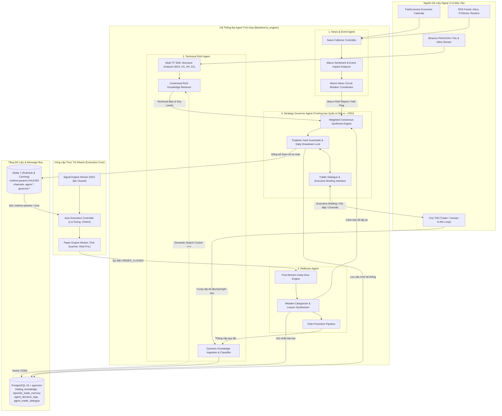
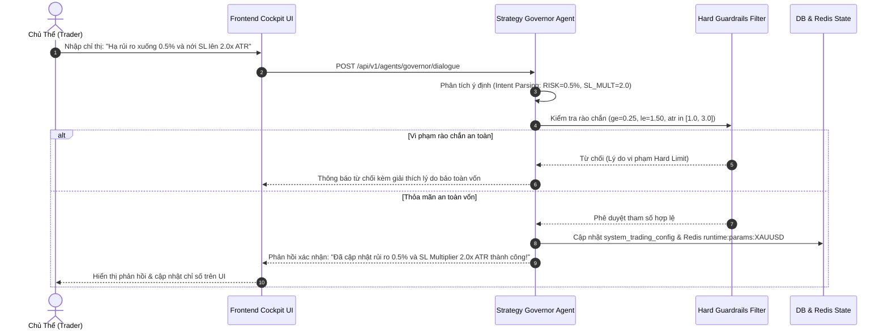

# KIẾN TRÚC KỸ THUẬT: GIAI ĐOẠN 3 - SPRINT 2 (PHASE 03 - SPRINT 02)
## HỆ THỐNG ĐA AGENT TÍCH HỢP (INTEGRATED MULTI-AGENT TRADING SYSTEM)

> **Trạng thái:** DRAFT ARCHITECTURE SPECIFICATION FOR REVIEW  
> **Tài liệu nền:** [Architecture.md](Architecture.md), [technical_system.md](technical_system.md)  
> **Tài liệu Sprint trước:** [Architecture_phase_03_sprint_01.md](Architecture_phase_03_sprint_01.md), [Backlog.md](Backlog.md)  
> **Framework tham chiếu:** Tauric Research TradingAgents (`https://github.com/tauricresearch/tradingagents`)  
> **Phạm vi (Scope):** Xây dựng hệ thống Đa Agent tích hợp với 4 Agent chuyên trách hoạt động độc lập và gắn kết:
> 1. **News & Event Agent:** Điều khiển thu thập tin tức, quét lịch kinh tế, phân tích tác động thị trường vĩ mô & điều phối Circuit Breaker.
> 2. **Technical RAG Agent:** Tiếp nhận tri thức cung cấp, phân loại đa trường phái (CMT, ICT, Wyckoff, Inducement/Trap Trading, SMC), lưu trữ Vector DB, truy vấn RAG và phân tích kỹ thuật hợp lưu đa khung thời gian.
> 3. **Reflexion Agent:** Học tập tự động từ toàn bộ vòng đời lệnh đóng (Win/Loss/BE), xây dựng taxonomy lỗi, đúc kết bài học và xúc tiến quy tắc mới vào hệ thống tri thức.
> 4. **Strategy Governor Agent:** Tổng hợp đồng thuận có trọng số, ra quyết định tự trị trong phạm vi thẩm quyền, bảo vệ rào chắn cứng (Hard Guardrails) và giao tiếp trực tiếp hai chiều với Chủ thể (Trader Human-in-the-Loop).  
> **Ngoài phạm vi (Out of Scope):** Kết nối API MT5 Live Real Money (thuộc Phase 04); Huấn luyện lại weights mô hình Deep Learning từ đầu (sử dụng LLM API và Embedding Vector Cosine Similarity).  
> **Ngày lập:** 2026-10-11  

---

## MỤC LỤC
1. [Mục tiêu và Định hướng Trọng tâm Sprint 02](#1-mục-tiêu-và-định-hướng-trọng-tâm-sprint-02)
2. [Quyết định Kiến trúc Mới (Decision Log D19–D24)](#2-quyết-định-kiến-trúc-mới-decision-log-d19d24)
3. [Kiến trúc Tổng thể Hệ thống Đa Agent & Luồng Tương tác](#3-kiến-trúc-tổng-thể-hệ-thống-đa-agent--luồng-tương-tác)
4. [Thiết kế Chi tiết 4 Chuyên trách Agent](#4-thiết-kế-chi-tiết-4-chuyên-trách-agent)
   - [4.1. News & Event Agent](#41-news--event-agent-quản-trị-tin-tức-lịch-kinh-tế--tác-động-vĩ-mô)
   - [4.2. Technical RAG Agent](#42-technical-rag-agent-tiếp-nhận-tri-thức-lưu-trữ--phân-tích-kỹ-thuật)
   - [4.3. Reflexion Agent](#43-reflexion-agent-học-tập-từ-giao-dịch--vòng-lặp-tiến-hóa)
   - [4.4. Strategy Governor Agent](#44-strategy-governor-agent-đồng-thuận-tự-trị--giao-tiếp-chủ-thể)
5. [Giao thức Tương tác Liên Agent & Giao tiếp Chủ thể (Human-in-the-Loop)](#5-giao-thức-tương-tác-liên-agent--giao-tiếp-chủ-thể-human-in-the-loop)
6. [Mô hình Dữ liệu & Schema Bổ sung (`0006_phase3_sprint2_agents.sql`)](#6-mô-hình-dữ-liệu--schema-bổ-sung)
7. [Hợp đồng Giao tiếp: REST API & WebSocket Protocol](#7-hợp-đồng-giao-tiếp-rest-api--websocket-protocol)
8. [Kiến trúc Giao diện Cockpit Nâng cao (Multi-Agent Cockpit Studio)](#8-kiến-trúc-giao-diện-cockpit-nâng-cao)
9. [Kế hoạch Triển khai theo Task (Task Breakdown T1–T5)](#9-kế-hoạch-triển-khai-theo-task)
10. [Kiểm thử, SLO & Tiêu chuẩn Nghiệm thu (Definition of Done)](#10-kiểm-thử-slo--tiêu-chuẩn-nghiệm-thu)

---

## 1. MỤC TIÊU VÀ ĐỊNH HƯỚNG TRỌNG TÂM SPRINT 02

### 1.1. Bối cảnh Kế thừa từ Sprint 01
Trong Phase 03 - Sprint 01, hệ thống đã hoàn thiện toàn bộ nền móng cốt lõi:
* **Hạ tầng Vector Database:** Docker `pgvector/pgvector:pg16` với extension `vector 0.8.7`, bảng `trading_knowledge` (chỉ mục HNSW) và `episodic_trade_memory`.
* **Dịch vụ Embeddings & RAG:** Mô hình vector 1536 chiều hỗ trợ cả Cloud API và Local Deterministic Feature Hashing, phân tách 18 tri thức chuẩn hóa (SMC, Price Action, Macro Risk, Post-Mortem).
* **Động cơ Reflexion sơ khai:** Phân tích post-mortem lệnh đóng và lưu trữ ký ức học tập.
* **Strategy Governor & Hard Guardrails:** Đóng vòng lặp an toàn với rào chắn Pydantic, Daily Drawdown Lock 3%, cập nhật `system_trading_config` và Redis `runtime:params:XAUUSD`.
* **Cockpit UI & Backtest Lab:** Hoàn thiện bảng điều khiển AI, RAG modal, và nâng cấp Backtest Lab đa khung thời gian với rủi ro chuẩn 1% vốn.

### 1.2. Thách thức Hiện tại & Bước Chuyển mình Lên Sprint 02
Mặc dù hạ tầng đã sẵn sàng, các thành phần AI hiện tại vẫn hoạt động dưới dạng các **dịch vụ phân mảnh (isolated services)** chạy tuần tự thụ động, chưa hình thành một **Hệ sinh thái Đa Agent Tự trị (Integrated Multi-Agent Ecosystem)** thực thụ:
1. **News & Event Agent:** Chưa chủ động điều khiển chu trình thu thập tin tức; dữ liệu tin RSS và lịch kinh tế còn tách rời, chưa có cơ chế tổng hợp phân tích vĩ mô định lượng (Quantitative Macro Bias) cho Vàng (XAUUSD).
2. **Technical RAG Agent:** Hiện tại chỉ đọc tài liệu tĩnh được nạp sẵn từ file; chưa có khả năng **tiếp nhận tri thức mới do trader cung cấp trực tiếp**, chưa tự động phân loại, đánh chỉ mục và truy vấn thông minh tương ứng với từng trạng thái thị trường thực tế.
3. **Reflexion Agent:** Chưa khép kín vòng lặp tiến hóa; các bài học rút ra chưa được tự động sàng lọc để "thăng cấp" (promote) thành các quy tắc chiến lược chính thức nạp vào hệ thống tri thức dài hạn.
4. **Strategy Governor Agent:** Mới chỉ xử lý tính toán số học nội bộ; **chưa có kênh giao tiếp trực tiếp với Chủ thể (Trader / Human-in-the-Loop)** để giải trình lý do ra quyết định, xin phê duyệt lệnh quan trọng hoặc tiếp nhận chỉ thị ghi đè (Trader Override) qua ngôn ngữ tự nhiên.

### 1.3. Định hướng Mở rộng Hệ thống Tri thức Đa Trường phái (Extensible Multi-School Knowledge Vision)
Bộ khung phân loại 5 nhóm baseline ban đầu (`SMC`, `PRICE_ACTION`, `RISK_MANAGEMENT`, `MACRO`, `POST_MORTEM`) đã đáp ứng đầy đủ yêu cầu vận hành kỹ thuật cốt lõi và hình thành một hệ thống giao dịch khép kín. **Tuy nhiên, 5 nhóm này hoàn toàn không phải là chuẩn mực duy nhất hay giới hạn đóng của hệ thống.**

Hệ thống RAG và Knowledge Ingestion trong Phase 03 - Sprint 02 được thiết kế với **kiến trúc mở (Open & Extensible Architecture)**, sẵn sàng tiếp nhận, phân loại, lập chỉ mục và kết hợp các trường phái học thuật đỉnh cao trong giới tài chính:
* **Bộ khung Học thuật CMT (Chartered Market Technician):** Khung tiêu chuẩn vàng phân tích kỹ thuật chuẩn quốc tế (Lý thuyết Dow, Cấu trúc xu hướng đỉnh/đáy, Tính đảo cực Hỗ trợ/Kháng cự Polarity Principle, Phân tích dao động động lượng Momentum Oscillator, Phân tích liên thị trường Intermarket Analysis giữa Vàng XAU, Dollar Index DXY, Lợi suất Trái phiếu Mỹ US10Y và Real Yields).
* **Phương thức ICT (Inner Circle Trader Methodology):** Khai thác dòng lệnh thuật toán liên ngân hàng IPDA (Interbank Price Delivery Algorithm), Mô hình Power of 3 (AMD: Accumulation - Manipulation - Distribution), Cú bẫy Judas Swing mở phiên, Vùng vào lệnh tối ưu OTE (Optimal Trade Entry 62% - 79% Fibonacci), Khoảng trống thanh khoản Liquidity Void, FVG Imbalance Mitigation.
* **Phương pháp Wyckoff (Cội nguồn của SMC & ICT):** Nền tảng tư duy dòng tiền thông minh Composite Man, 4 chu kỳ lớn (Tích lũy, Tăng giá, Phân phối, Giảm giá), 5 Pha cấu trúc (Phase A đến Phase E), Mẫu hình Spring (Rũ bỏ Phase C) / UTAD (Upthrust After Distribution), Dấu hiệu sức mạnh SOS (Sign of Strength) / Dấu hiệu suy yếu SOW (Sign of Weakness), Phân tích nỗ lực và kết quả VSA (Volume Spread Analysis: Effort vs Result).
* **Inducement & Trap Trading:** Kỹ thuật bóc tách bẫy thanh khoản tinh vi: Điểm dẫn dụ Inducement (IDM) phân biệt thanh khoản nội bộ và thanh khoản cấu trúc thật, Bẫy thanh khoản nhân tạo (Engineering Liquidity, Equal Highs EQH / Equal Lows EQL traps), Bẫy phá vỡ giả (Bull/Bear Traps, Turtle Soup, False Breakouts) nhằm quét sạch lệnh Stop Loss của Retail Traders trước khi giá di chuyển thật.
* **Dữ liệu & Tri thức Tiếp diễn:** Bất kỳ tài liệu học thuật, nghiên cứu định lượng, sách chuyên sâu hay ghi chú kinh nghiệm nào của Chủ thể đều có thể được tiếp nhận và số hóa thành vector tri thức mà không làm xáo trộn kiến trúc hệ thống.

### 1.4. Mục tiêu Trọng tâm của Sprint 02
Sprint 02 tập trung vào việc **nâng tầm 4 Agent chuyên trách thành các thực thể thông minh tự trị, tích hợp và có khả năng tương tác sâu**:

```
+─────────────────────────────────────────────────────────────────────────────────────────────+
|                                     CHỦ THỂ (TRADER / HUMAN)                                |
|           ▲                                   ▲                                   ▲         |
|           │ Chỉ thị ghi đè (Override)        │ Cung cấp tri thức mới             │ Phê duyệt|
|           │ Nhận giải trình (Briefing)        │ (Sách, ghi chú, setup)            │ lệnh nhạy|
|           ▼                                   ▼                                   ▼ cảm      |
|  +───────────────────+             +──────────────────────+             +─────────────────+ |
|  | Strategy Governor |◄────────────|  Technical RAG Agent |◄────────────| Reflexion Agent | |
|  | (CRO & Chỉ huy)   |             |  (Tiếp nhận & Kỹ thuật)             | (Học tập lệnh)  | |
|  +────────▲──────────+             +──────────▲───────────+             +────────▲────────+ |
|           │                                   │                                  │          |
|           │ Báo cáo rủi ro vĩ mô             │ Dữ liệu nến & Mẫu hình           │ Lệnh     |
|           │ Cảnh báo Circuit Breaker          │ Truy vấn Vector RAG              │ đóng     |
|  +────────┴──────────+             +──────────┴───────────+                      │          |
|  | News & Event Agent|             | Post-Mortem Feedback |──────────────────────┘          |
|  | (Thu thập & Vĩ mô)|             | Loop (Quy tắc mới)   |                                 |
|  +───────────────────+             +──────────────────────+                                 |
+─────────────────────────────────────────────────────────────────────────────────────────────+
```

---

## 2. QUYẾT ĐỊNH KIẾN TRÚC MỚI (DECISION LOG D19–D24)

| ID | Quyết định Kiến trúc | Trạng thái | Tác động Kỹ thuật & Lý do Thiết kế |
| :--- | :--- | :---: | :--- |
| **D19** | **Cấu trúc Agent Hướng Chuyên trách (Specialist Agent Architecture) với Chu trình Tự trị Riêng** | `ACCEPTED` | Mỗi Agent là một thực thể độc lập (`BaseAgent`) sở hữu State nội bộ, chu kỳ kích hoạt riêng (Event-driven hoặc Scheduled cron) và công cụ chuyên biệt (Tools), không gộp chung vào một hàm khổng lồ. |
| **D20** | **Hệ thống Tri thức Mở rộng & Phân loại Đa Trường phái (Extensible Multi-School Taxonomy & Dynamic Ingestion)** | `ACCEPTED` | 5 nhóm ban đầu đóng vai trò Core Baseline. Hệ thống xây dựng mô hình phân loại mở rộng: Trường phái (`school_of_thought`: `WYCKOFF`, `ICT`, `CMT`, `INDUCEMENT_TRAPS`, `SMC`, `PRICE_ACTION`, `RISK_MANAGEMENT`, `MACRO`, `POST_MORTEM`), Danh mục cấp 2 (`category`), Phân nhóm chi tiết (`sub_categories`), Nhãn tag đa chiều (`tags`) và Nguồn học thuật (`academic_reference`). CSDL sử dụng `VARCHAR(64)` kết hợp GIN index trên `metadata JSONB`, không hardcode enum đóng. |
| **D21** | **Giao thức Đồng thuận Có Trọng số (Weighted Consensus Protocol) & Matrix Quyền hạn Cấp bậc** | `ACCEPTED` | Strategy Governor không quyết định cảm tính; áp dụng ma trận trọng số minh bạch: Technical (40%), Macro News (35%), Reflexion History (25%). Tín hiệu chỉ được thông qua khi đạt điểm an toàn $\ge 0.70$ và không bị vi phạm Circuit Breaker. |
| **D22** | **Kênh Giao tiếp Trực tiếp Chủ thể - Governor (Trader - Governor Human-in-the-Loop Hub)** | `ACCEPTED` | Thiết lập cơ chế tương tác hai chiều: Governor chủ động gửi Executive Briefing / Approval Requests qua WebSocket; Chủ thể có thể gửi lệnh điều chỉnh, đặt câu hỏi hoặc ghi đè tham số qua giao diện Chat Console. |
| **D23** | **Tự động Thăng cấp Quy tắc từ Ký ức Thực nghiệm (Reflexion-to-Knowledge Rule Promotion)** | `ACCEPTED` | Khi một lỗi hoặc bài học được Reflexion Agent ghi nhận và xác thực qua $\ge 3$ lệnh tương đồng, hệ thống cho phép tự động hoặc có xác nhận của Trader thăng cấp quy tắc đó thành tri thức chính thức trong `trading_knowledge` (`source_type = 'REFLEXION_PROMOTED'`). |
| **D24** | **Bảo toàn Chuẩn Cách ly D18 & Single Source of Truth (`system_trading_config` + Redis)** | `ACCEPTED` | Mọi bảng dữ liệu mới đều có cờ `is_test BOOLEAN`. Cấu hình thực thi động vẫn tập trung tại `system_trading_config` và Redis `runtime:params:XAUUSD`, duy trì độ trễ đọc lệnh $< 1\text{ms}$ cho AutoExecutor. |

---

## 3. KIẾN TRÚC TỔNG THỂ HỆ THỐNG ĐA AGENT & LUỒNG TƯƠNG TÁC

Hệ thống hoạt động theo mô hình **Phân tầng Trí tuệ Bất đồng bộ (Decoupled Asynchronous Intelligence Layer)** kết hợp với **Vòng lặp Thực thi Tốc độ cao (Fast Execution Loop)**:



---

## 4. THIẾT KẾ CHI TIẾT 4 CHUYÊN TRÁCH AGENT

### 4.1. News & Event Agent (Quản trị Tin tức, Lịch kinh tế & Tác động Vĩ mô)

#### A. Nhiệm vụ & Vai trò Kỹ thuật
* **Chủ động điều khiển hệ thống thu thập tin tức:** Không để scraper chạy thụ động, Agent điều phối lịch quét linh hoạt:
  * Trạng thái bình thường: Quét lịch kinh tế mỗi 30 phút, RSS mỗi 5 phút.
  * Trạng thái áp sát sự kiện 3 sao ($\le 60$ phút) hoặc có tin bất thường: Tăng tần suất quét lên 1 phút/lần.
* **Phân tích tác động kinh tế vĩ mô đối với Vàng (XAUUSD):**
  * Định lượng hóa các chỉ số quan trọng: **NFP** (Non-Farm Payrolls), **CPI / Core CPI**, **FOMC Rate Decision & Press Conference**, **GDP**, **Retail Sales**, **PPI**, **Jobless Claims**.
  * So sánh giá trị Thực tế (*Actual*) với Dự báo (*Forecast*) và Kỳ trước (*Previous*) để tính độ lệch chuẩn (Surprise Factor).
  * Quy đổi tác động tương quan tới chỉ số USD Index (DXY) $\to$ Tác động nghịch chiều tới Vàng (XAUUSD).
* **Định lượng cảm xúc thị trường (Macro Sentiment Score):**
  * Chuẩn hóa điểm cảm xúc $S \in [-1.0, +1.0]$:
    * $S > +0.25$: Vĩ mô ủng hộ Vàng tăng giá (Dovish Fed, lạm phát cao kéo dài, rủi ro địa chính trị).
    * $-0.25 \le S \le +0.25$: Bối cảnh vĩ mô trung tính.
    * $S < -0.25$: Vĩ mô bất lợi cho Vàng (Hawkish Fed, USD mạnh lên, lợi suất trái phiếu Mỹ tăng vọt).
* **Điều phối Bộ ngắt mạch Vĩ mô (Macro News Circuit Breaker):**
  * Kích hoạt cờ ngắt mạch `market_risk_flag = 'HIGH_RISK_HALT'` trong cửa sổ $\pm 30$ phút quanh tin 3 sao.
  * Phát cảnh báo khẩn cấp `NEWS_CIRCUIT_BREAKER_TRIGGERED` lên Redis Message Bus và đẩy báo cáo trực tiếp sang Strategy Governor.

#### B. Cấu trúc Dữ liệu Đầu ra (`MacroInsightReport`)
```json
{
  "agent": "NEWS_AND_EVENT_AGENT",
  "timestamp": "2026-10-11T14:30:00Z",
  "macro_sentiment_score": 0.42,
  "macro_bias": "BULLISH_GOLD",
  "dxy_correlation_bias": "BEARISH_DXY",
  "active_circuit_breaker": true,
  "circuit_breaker_details": {
    "event_name": "US Core CPI m/m",
    "impact_stars": 3,
    "event_timestamp": "2026-10-11T14:30:00Z",
    "mins_to_event": 0.0,
    "buffer_mins": 30,
    "status": "HALT_ACTIVE"
  },
  "breaking_news_alerts": [
    {
      "headline": "Middle East geopolitical tension escalates, safe-haven demand spikes",
      "urgency": "HIGH",
      "detected_at": "2026-10-11T14:15:20Z"
    }
  ],
  "recommendation_for_governor": {
    "action": "HALT_NEW_ORDERS",
    "reason": "High-impact US CPI release window active (+/- 30 mins)",
    "suggested_risk_scale": 0.5
  }
}
```

---

### 4.2. Technical RAG Agent (Tiếp nhận Tri thức, Lưu trữ & Phân tích Kỹ thuật)

#### A. Nhiệm vụ & Vai trò Kỹ thuật
Technical RAG Agent không chỉ là một bộ phân tích kỹ thuật đơn thuần, mà đóng vai trò là **Viện Hàn Lâm Chiến Lược & Chuyên Gia Phân Tích Cấu Trúc Đa Khung Thời Gian**. Agent sở hữu kiến trúc tri thức mở (Extensible Multi-School Knowledge System), cho phép số hóa và hợp lưu nhiều trường phái học thuật đỉnh cao:

```
+─────────────────────────────────────────────────────────────────────────────────────────────────+
|               BỘ KHUNG TRI THỨC MỞ RỘNG ĐA TRƯỜNG PHÁI (MULTI-SCHOOL KNOWLEDGE TAXONOMY)        |
+───────────────────────────┬───────────────────────────┬─────────────────────────────────────────+
| 1. WYCKOFF METHOD         | 2. ICT METHODOLOGY        | 3. CMT ACADEMIC FRAMEWORK               |
| (Cội nguồn Smart Money)   | (Dòng lệnh Liên ngân hàng)| (Chuẩn mực Phân tích Quốc tế)           |
| - Composite Man Theory    | - IPDA Algorithm Delivery | - Dow Theory: Trend & Phase Confirmation|
| - Accumulation (Phase A-E)| - AMD (Power of 3)        | - Support/Resistance Polarity Principle |
| - Spring / Shakeout Test  | - Judas Swing Fakeout     | - Volume & Momentum Confirmation        |
| - Distribution / UTAD     | - OTE (Fib 62% - 79%)     | - Intermarket Analysis (XAU-DXY-US10Y)  |
| - VSA: Effort vs Result   | - Liquidity Voids & FVG   | - Volatility Regimes (ATR, Bands)       |
+───────────────────────────┼───────────────────────────┴─────────────────────────────────────────+
| 4. INDUCEMENT & TRAP      | 5. HỆ THỐNG VẬN HÀNH CỐT LÕI (CORE BASELINE CLUSTERS)               |
| (Bẫy Thanh khoản Chuyên sâu)| - SMC (Order Block, BOS/CHoCH, Liquidity Pool, Mitigation)          |
| - Inducement (IDM) Points | - PRICE_ACTION (Absorption Pinbar, Engulfing, Multi-bar Wick Trap)  |
| - Internal vs External Liq| - RISK_MANAGEMENT (Position Sizing, Capital Preservation, Asymmetry)|
| - Engineering Liq (EQH/EQL| - MACRO (Session Kill Zones, High-Impact News Buffer)               |
| - False Breakout / Turtle | - POST_MORTEM (Bài học từ sai lầm thực chiến đã được kiểm nghiệm)   |
+───────────────────────────┴─────────────────────────────────────────────────────────────────────+
```

##### 1. Tiếp nhận Tri thức Động & Cơ chế Đa Nhãn Thứ bậc (Hierarchical & Multi-Label Ingestion)
* **Tiếp nhận linh hoạt từ Chủ thể:** Trader có thể nạp bất kỳ tài liệu, giáo trình CMT, bài giảng ICT, sơ đồ Wyckoff, bài học Inducement Trap hoặc ghi chú cá nhân dưới dạng Markdown/Text/PDF.
* **Mô hình Dữ liệu Đa Chiều (Multi-Dimensional Knowledge Indexing):**
  * `school_of_thought`: Trường phái chính (`WYCKOFF`, `ICT`, `CMT`, `INDUCEMENT_TRAPS`, `SMC`, `PRICE_ACTION`, `RISK_MANAGEMENT`, `MACRO`, `POST_MORTEM`, hoặc trường phái do người dùng tự đặt).
  * `category`: Danh mục phân loại cấp 2 (ví dụ: `ACCUMULATION_SCHEMATIC`, `LIQUIDITY_ENGINEERING`, `INTERMARKET_MACRO`, `POWER_OF_3`).
  * `sub_categories`: Mảng các khái niệm con (ví dụ: `["PHASE_C", "SPRING", "SOS", "TEST"]`).
  * `tags`: Nhãn truy vấn nhanh (ví dụ: `["VOLUME_SPREAD", "EFFORT_VS_RESULT", "JUDAS_SWING", "IDM"]`).
  * `academic_reference`: Nguồn trích dẫn học thuật (ví dụ: *"CMT Level II: Intermarket Technical Analysis / Wyckoff Method 1931"*).
* **Vector hóa Đa Tầng:** Chuyển đổi toàn văn và tóm tắt thành vector 1536 chiều thông qua `EmbeddingService`, lập chỉ mục HNSW vector Cosine Similarity trên PostgreSQL `trading_knowledge`.

##### 2. Tổng Hợp Chéo Đa Trường Phái (Cross-School Synthesis Confluence Engine)
Khi phân tích biểu đồ giá Vàng XAUUSD, Technical RAG Agent không nhìn nhận phiến diện qua một chỉ báo đơn lẻ mà thực hiện **Hợp lưu đa trường phái (Cross-School Confluence)** để tìm kiếm thiết lập giao dịch có xác suất thắng cao nhất (Highest Probability Edge):
* **Ví dụ Hợp lưu 4 Trường phái (Confluence Setup):**
  1. *Wyckoff Method:* Nhận diện nến M15 đang ở Pha C của mô hình Tích lũy (Accumulation Phase C), hình thành cú rũ bỏ Spring xuyên qua đáy cũ.
  2. *ICT Methodology:* Nhận diện cú rũ bỏ xảy ra đúng khung giờ mở phiên Luân Đôn (London Open Kill Zone 02:00–05:00 EST), tạo thành bẫy Judas Swing mở rộng biên độ.
  3. *Inducement & Trap Trading:* Xác nhận giá đã quét sạch điểm dẫn dụ Inducement (IDM) và quét cụm thanh khoản nhân tạo Equal Lows (EQL Trap) của retail traders.
  4. *CMT Academic Analysis:* Khối lượng giao dịch bùng nổ vượt $2.5\times$ trung bình 20 phiên nhưng thân nến đóng rút chân Pinbar tăng mạnh $\to$ Xác nhận nguyên lý Wyckoff/CMT: *Nỗ lực bán khổng lồ nhưng kết quả giá không giảm tiếp (Effort vs Result divergence) chứng tỏ Smart Money đã hấp thụ toàn bộ lực bán*.

##### 3. Truy vấn Tri thức RAG Theo Ngữ Cảnh Nến (Contextual Semantic RAG Retrieval)
* Khi nến M15 đóng, Agent trích xuất đặc trưng hình thái (quét râu, phá vỡ cấu trúc, vị trí trong phiên).
* Tự động tạo câu truy vấn ngữ nghĩa kết hợp (Hybrid Query): `"Wyckoff accumulation spring phase C confluence with London Judas swing and inducement sweep"`.
* Truy vấn Vector DB với Cosine Similarity để trích xuất 2–3 trích đoạn tri thức liên quan nhất, đưa vào LLM Context Prompt để đối chiếu quy tắc vào lệnh và Stop Loss tối ưu.

#### B. Cấu trúc Dữ liệu Đầu ra (`TechnicalAnalysisReport`)
```json
{
  "agent": "TECHNICAL_RAG_AGENT",
  "timestamp": "2026-10-11T14:45:00Z",
  "timeframe_focus": "M15",
  "market_regime": "TRENDING_EXPANSION",
  "structural_bias": "BULLISH",
  "confidence_score": 0.92,
  "cross_school_analysis": {
    "wyckoff": {
      "phase": "PHASE_C_SPRING",
      "schematic": "ACCUMULATION_TYPE_1",
      "vsa_signal": "EFFORT_VERSUS_RESULT_BULLISH_ABSORPTION"
    },
    "ict": {
      "session": "LONDON_OPEN_KILL_ZONE",
      "power_of_3": "MANIPULATION_COMPLETE",
      "pattern": "JUDAS_SWING_SWEEP_LOW",
      "ote_zone": [4182.50, 4184.20]
    },
    "inducement_and_traps": {
      "idm_cleared": true,
      "trap_type": "EQUAL_LOWS_LIQUIDITY_ENGINEERED",
      "cleared_liquidity_price": 4180.20
    },
    "cmt_academic": {
      "dow_trend": "POTENTIAL_HIGHER_LOW_REVERSAL",
      "intermarket_bias": "DXY_REJECTING_RESISTANCE",
      "volume_confirmation": "HIGH_CLIMACTIC_ABSORPTION"
    }
  },
  "retrieved_knowledge_chunks": [
    {
      "id": 28,
      "title": "Wyckoff Phase C Spring & Volume Spread Absorption",
      "school_of_thought": "WYCKOFF",
      "category": "ACCUMULATION_SCHEMATIC",
      "similarity_score": 0.94,
      "core_rule": "Spring trong Phase C là cơ hội mua tối ưu nhất của toàn bộ chu kỳ tích lũy khi đi kèm khối lượng hấp thụ lớn và đóng cửa trở lại vào Trading Range."
    },
    {
      "id": 35,
      "title": "ICT Judas Swing Confluence with Inducement Sweep",
      "school_of_thought": "ICT",
      "category": "POWER_OF_3",
      "similarity_score": 0.91,
      "core_rule": "Cú quét Judas Swing đầu phiên Âu rũ sạch thanh khoản IDM là setup đảo chiều với R:R tối thiểu 1:2.5 đến 1:3.0."
    }
  ],
  "suggested_trade_setup": {
    "action": "BUY",
    "entry_zone": [4183.00, 4184.50],
    "suggested_sl": 4178.90,
    "suggested_tp": 4197.50,
    "planned_risk_reward": 2.5
  }
}
```

---

### 4.3. Reflexion Agent (Học tập Từ Giao dịch & Vòng lặp Tiến hóa)

#### A. Nhiệm vụ & Vai trò Kỹ thuật
* **Giám sát toàn bộ chu trình lệnh đóng:**
  * Lắng nghe sự kiện `ORDER_CLOSED` từ `PaperEngineWorker` và kết quả từ `BacktestLab`.
  * Trích xuất thông số chi tiết: Điểm vào, Điểm thoát, Thời gian giữ lệnh, Drawdown tối đa trong lệnh (MAE - Maximum Adverse Excursion), Lợi nhuận tiềm năng tối đa (MFE - Maximum Favorable Excursion), bối cảnh tin tức và nến xung quanh.
* **Phân tích Post-Mortem Chuyên Sâu & Phân Loại Sai Lầm:**
  * **Lệnh THUA (Loss):** Đối chiếu với Taxonomy lỗi chuẩn hóa:
    * `SL_TOO_TIGHT`: Giá cắn SL chưa tới 5 points rồi quay đầu chạy đúng hướng $\to$ Đề xuất nới `atr_sl_multiplier`.
    * `EARLY_ENTRY_BEFORE_CHOCH`: Vào lệnh khi chưa có nến xác nhận phá vỡ cấu trúc.
    * `TRADED_DURING_NEWS_SPIKE`: Vào lệnh sát giờ tin tức 3 sao dẫn đến trượt giá/quét râu.
    * `COUNTER_TREND_FADING`: Bắt đỉnh/đáy ngược xu hướng H4/D1 mà không có tín hiệu xác nhận mạnh.
    * `FOMO_CHASING`: Vào lệnh khi nến đã chạy xa khỏi POI $> 2.0 \times \text{ATR}$.
  * **Lệnh THẮNG (Win):** Đánh giá tính chuẩn mực (High Edge Setup) hay chỉ là lệnh thắng may mắn (Lucky Bad Trade).
  * **Lệnh HÒA VỐN (Breakeven):** Đánh giá việc dời SL về BE có quá sớm khiến lệnh bị đóng non trước khi đạt mục tiêu lớn hay không.
* **Đúc kết Bài học & Tự động Thăng cấp Quy tắc (Rule Promotion Pipeline):**
  * Tạo bản ghi ký ức `episodic_trade_memory` kèm embedding 1536 chiều để phục vụ tìm kiếm tương đồng.
  * **Cơ chế Thăng cấp (Promotion):** Khi một loại sai lầm lặp lại $\ge 2$ lần trong 10 lệnh gần nhất, Agent tự động tổng hợp thành một Quy tắc Cải tiến (`promoted_rule`).
  * Quy tắc này được gửi sang Strategy Governor để áp dụng ngay vào tham số vận hành, đồng thời đẩy vào `trading_knowledge` danh mục `POST_MORTEM` để toàn bộ hệ thống tham chiếu dài hạn.

#### B. Cấu trúc Dữ liệu Đầu ra (`ReflexionFeedbackReport`)
```json
{
  "agent": "REFLEXION_AGENT",
  "timestamp": "2026-10-11T15:10:00Z",
  "evaluated_order_id": 1058,
  "outcome": "LOSS",
  "realized_pnl": -100.0,
  "mistake_category": "SL_TOO_TIGHT",
  "root_cause_analysis": "Lệnh SELL đặt SL tại 4192.94 (cách entry 4.15 giá = 1.0x ATR). Giá quét râu lên 4193.80 do biến động mở phiên Luân Đôn rồi giảm mạnh về 4180.00.",
  "lesson_learned": "Trong phiên Luân Đôn mở cửa, biên độ râu nến quét thanh khoản thường rộng hơn 1.5x ATR. Cần dự phòng buffer tối thiểu 1.8x ATR.",
  "rule_to_add": "Tự động nới atr_sl_multiplier từ 1.5 lên 1.8 - 2.0 khi giao dịch trong 45 phút đầu của phiên Luân Đôn.",
  "promotion_status": "READY_FOR_GOVERNOR_APPROVAL",
  "learning_analytics": {
    "total_memories": 42,
    "recent_10_trades_winrate": 0.60,
    "repeated_mistake_frequency": {
      "SL_TOO_TIGHT": 3,
      "EARLY_ENTRY": 1
    }
  }
}
```

---

### 4.4. Strategy Governor Agent (Đồng thuận, Tự trị & Giao tiếp Chủ thể)

#### A. Nhiệm vụ & Vai trò Kỹ thuật
Strategy Governor đóng vai trò là **Giám đốc Quản trị Rủi ro (Chief Risk Officer - CRO) kiêm Tổng chỉ huy Vận hành**:

```
                               ┌───────────────────────────┐
                               │   News & Event Agent      │ (Trọng số 35%)
                               └─────────────┬─────────────┘
                                             │
┌───────────────────────────┐                ▼                ┌───────────────────────────┐
│   Technical RAG Agent     │ ──► [ STRATEGY GOVERNOR ] ◄─── │      Reflexion Agent      │
│   (Trọng số 40%)          │     (Consensus & CRO)           │      (Trọng số 25%)       │
└───────────────────────────┘                │                └───────────────────────────┘
                                             ▼
                               ┌───────────────────────────┐
                               │  Pydantic Hard Guardrails │
                               │  & Daily Drawdown Lock 3% │
                               └─────────────┬─────────────┘
                                             │
                        ┌────────────────────┴────────────────────┐
                        ▼                                         ▼
            [ TỰ TRỊ THI HÀNH ]                       [ GIAO TIẾP VỚI CHỦ THỂ ]
            - Đồng bộ cấu hình DB & Redis             - Executive Briefing tóm tắt
            - Điều chỉnh rủi ro 0.25% - 1.5%          - Xin phê duyệt lệnh nhạy cảm
            - Nới / Thu SL 1.0x - 3.0x                - Tiếp nhận chỉ thị ghi đè
```

#### B. Ba Phân Hệ Cốt Lõi của Strategy Governor
1. **Hội đồng Đồng thuận Đa Agent (Weighted Consensus Engine):**
   * Tổng hợp điểm đồng thuận:
     $$C = 0.40 \times S_{\text{tech}} + 0.35 \times S_{\text{macro}} + 0.25 \times S_{\text{reflexion}}$$
   * Chỉ khi $C \ge 0.70$, không có vi phạm Circuit Breaker từ News Agent, và tỷ lệ R:R $\ge 1.50$ thì lệnh mới được cấp phép thực thi.
2. **Ra Quyết định Tự trị trong Phạm vi Thẩm quyền (Autonomous Decision Matrix & Hard Guardrails):**
   * **Thẩm quyền tự động điều chỉnh:**
     * `risk_per_trade_percent`: Điều chỉnh linh hoạt trong khoảng $[0.25\%, 1.50\%]$ (tự động giảm $50\%$ nếu chuỗi lỗ gần nhất $\ge 3$ lệnh).
     * `atr_sl_multiplier`: Tự động nới lên $1.8\times - 2.0\times$ nếu Reflexion Agent cảnh báo lỗi `SL_TOO_TIGHT`.
     * `min_risk_reward_ratio`: Giữ nghiêm ngặt $\ge 1.20$, tối ưu $\ge 2.00$.
   * **Rào chắn cứng tuyệt đối (Unbreakable Hard Guardrails):**
     * **Khóa Lỗ Ngày (Max Daily Drawdown 3.0%):** Nếu tổng lỗ thực tế trong ngày đạt $3.0\%$, Governor khóa cứng quyền giao dịch (`trading_allowed = False`), không một Agent hay thuật toán nào được phép mở lệnh mới.
     * **Khóa Tin Tức 3 Sao:** Ngắt giao dịch trong phạm vi $\pm 30$ phút của tin tức 3 sao USD.
   * **Đồng bộ Single Source of Truth:**
     * Ghi bền vững vào PostgreSQL `system_trading_config`.
     * Cập nhật tức thì vào Redis key `runtime:params:XAUUSD` ($<1\text{ms}$) để `AutoExecutionController` đọc trực tiếp.
3. **Giao tiếp Trực tiếp với Chủ thể (Trader Human-in-the-Loop Hub):**
   * **Báo cáo Lãnh đạo Điều hành (Executive Briefing):**
     * Định kỳ mỗi 15 phút hoặc khi thị trường có biến động lớn, Governor xuất bản bản tin tóm tắt bằng ngôn ngữ tự nhiên: Tình hình vĩ mô, cấu trúc kỹ thuật, trạng thái các Agent và nhận định rủi ro.
   * **Quy trình Xin Phê duyệt Lệnh (Approval Request Protocol):**
     * Ở chế độ `SEMI_AUTO`, hoặc khi một lệnh có độ tin cậy biên ($0.65 \le C < 0.75$), Governor không tự ý mở lệnh mà gửi thẻ **Yêu cầu Phê duyệt** lên giao diện Cockpit kèm bộ đếm lùi thời gian (ví dụ: 60 giây) để Trader duyệt hoặc bỏ qua.
   * **Tiếp nhận Chỉ thị Ghi đè từ Chủ thể (Trader Override & Command Ingestion):**
     * Trader có thể đối thoại hoặc ra lệnh trực tiếp:
       * *"Governor, tạm dừng giao dịch 2 tiếng để theo dõi tin tức."* $\to$ Governor chuyển `trading_allowed = False`, `halt_reason = "TRADER_OVERRIDE: Paused by user for 2 hours"`.
       * *"Hạ mức rủi ro xuống 0.5% hôm nay."* $\to$ Governor kiểm tra Hard Guardrails, cập nhật `risk_per_trade_percent = 0.50` và xác nhận thi hành.
       * *"Nới SL lên 2.2x ATR."* $\to$ Governor kiểm tra biên độ $[1.0, 3.0]$ và cập nhật thành công.
     * Nếu Trader đưa ra lệnh vượt ngoài rào chắn an toàn (ví dụ: *"Đặt rủi ro 5% gỡ lỗ"*), Governor **từ chối thực hiện**, viện dẫn nguyên tắc an toàn vốn và giải thích lý do cho Trader!

---

## 5. GIAO THỨC TƯƠNG TÁC LIÊN AGENT & GIAO TIẾP CHỦ THỂ (HUMAN-IN-THE-LOOP)

### 5.1. Kênh Bus Thông Điệp Redis Pub/Sub (Event Bus Channels)
Hệ thống sử dụng các kênh Redis Pub/Sub chuyên trách để duy trì tính bất đồng bộ cao và không làm nghẽn tiến trình:

| Tên Kênh Redis | Nguồn Phát (Publisher) | Đơn Vị Nhận (Subscriber) | Nội Dung / Mục Đích |
| :--- | :--- | :--- | :--- |
| `agent:news:event` | News & Event Agent | Governor, Frontend WS | Báo cáo vĩ mô, chỉ số cảm xúc, cảnh báo tin tức khẩn cấp. |
| `agent:technical:analysis` | Technical RAG Agent | Governor, Frontend WS | Báo cáo nhận định cấu trúc SMC, mẫu hình, vùng POI. |
| `agent:reflexion:lesson` | Reflexion Agent | Governor, Technical, WS | Bài học sau lệnh đóng, đề xuất quy tắc mới. |
| `governor:consensus` | Strategy Governor | Execution, Frontend WS | Quyết định đồng thuận, trạng thái phê duyệt tham số. |
| `governor:approval_request` | Strategy Governor | Frontend Cockpit | Yêu cầu phê duyệt lệnh gửi tới Trader. |
| `agent:trader:dialogue` | Trader / Governor | Trader Hub, Governor | Luồng đối thoại hai chiều giữa Chủ thể và Governor. |

### 5.2. Chu Trình Đối Thoại & Ghi Đè Tham Số (Human-in-the-Loop Protocol)


---

## 6. MÔ HÌNH DỮ LIỆU & SCHEMA BỔ SUNG (`0006_phase3_sprint2_agents.sql`)

Để hỗ trợ việc ghi nhận quyết định đồng thuận, lưu trữ lịch sử đối thoại với Trader và mở rộng năng lực phân loại tri thức, hệ thống bổ sung Migration số 6:

```sql
-- Migration: 0006_phase3_sprint2_agents.sql
-- Mục đích: Bổ sung bảng ghi nhật ký quyết định đa Agent, lịch sử đối thoại với Trader
-- và mở rộng nguồn gốc tri thức trong trading_knowledge.

-- 1. Bảng lưu trữ nhật ký quyết định đồng thuận của Strategy Governor
CREATE TABLE IF NOT EXISTS agent_decision_logs (
    id BIGSERIAL PRIMARY KEY,
    timestamp TIMESTAMPTZ NOT NULL DEFAULT NOW(),
    market_regime VARCHAR(64) NOT NULL,
    suggested_bias VARCHAR(32) NOT NULL,
    consensus_score NUMERIC(4, 2) NOT NULL,
    technical_confidence NUMERIC(4, 2) NOT NULL,
    macro_sentiment_score NUMERIC(4, 2) NOT NULL,
    active_circuit_breaker BOOLEAN NOT NULL DEFAULT FALSE,
    applied_risk_pct NUMERIC(4, 2) NOT NULL,
    applied_sl_mult NUMERIC(4, 2) NOT NULL,
    applied_min_rr NUMERIC(4, 2) NOT NULL,
    trading_allowed BOOLEAN NOT NULL DEFAULT TRUE,
    halt_reason TEXT,
    rationale_summary TEXT NOT NULL,
    agent_votes JSONB NOT NULL DEFAULT '{}'::jsonb,
    is_test BOOLEAN NOT NULL DEFAULT FALSE
);

CREATE INDEX IF NOT EXISTS idx_agent_decision_logs_timestamp ON agent_decision_logs(timestamp DESC);
CREATE INDEX IF NOT EXISTS idx_agent_decision_logs_is_test ON agent_decision_logs(is_test);

-- 2. Bảng lưu trữ lịch sử đối thoại giữa Chủ thể (Trader) và Strategy Governor
CREATE TABLE IF NOT EXISTS agent_trader_dialogue (
    id BIGSERIAL PRIMARY KEY,
    timestamp TIMESTAMPTZ NOT NULL DEFAULT NOW(),
    sender VARCHAR(32) NOT NULL,             -- 'TRADER' hoặc 'GOVERNOR'
    message_type VARCHAR(32) NOT NULL,       -- 'TEXT', 'COMMAND', 'BRIEFING', 'APPROVAL_REQUEST', 'OVERRIDE_CONFIRM'
    content TEXT NOT NULL,
    metadata JSONB NOT NULL DEFAULT '{}'::jsonb,
    approval_status VARCHAR(32),             -- 'PENDING', 'APPROVED', 'REJECTED', 'EXPIRED'
    is_test BOOLEAN NOT NULL DEFAULT FALSE
);

CREATE INDEX IF NOT EXISTS idx_agent_trader_dialogue_timestamp ON agent_trader_dialogue(timestamp DESC);
CREATE INDEX IF NOT EXISTS idx_agent_trader_dialogue_is_test ON agent_trader_dialogue(is_test);

-- 3. Mở rộng bảng trading_knowledge với nguồn gốc, trường phái và độ tin cậy tri thức
ALTER TABLE trading_knowledge
    ADD COLUMN IF NOT EXISTS school_of_thought VARCHAR(64) NOT NULL DEFAULT 'GENERAL', -- 'WYCKOFF', 'ICT', 'CMT', 'INDUCEMENT_TRAPS', 'SMC', 'PRICE_ACTION', 'MACRO', 'RISK_MANAGEMENT', 'POST_MORTEM'
    ADD COLUMN IF NOT EXISTS source_type VARCHAR(64) NOT NULL DEFAULT 'SYSTEM_CORE', -- 'SYSTEM_CORE', 'TRADER_PROVIDED', 'REFLEXION_PROMOTED'
    ADD COLUMN IF NOT EXISTS verified_by_trader BOOLEAN NOT NULL DEFAULT TRUE,
    ADD COLUMN IF NOT EXISTS confidence_score NUMERIC(4, 2) NOT NULL DEFAULT 1.00;

CREATE INDEX IF NOT EXISTS idx_trading_knowledge_school ON trading_knowledge(school_of_thought);
CREATE INDEX IF NOT EXISTS idx_trading_knowledge_source_type ON trading_knowledge(source_type);
CREATE INDEX IF NOT EXISTS idx_trading_knowledge_metadata ON trading_knowledge USING gin (metadata);
```

---

## 7. HỢP ĐỒNG GIAO TIẾP: REST API & WEBSOCKET PROTOCOL

### 7.1. REST API Controllers (`/api/v1/agents/`)

#### A. News & Event Agent Router (`/api/v1/agents/news`)
* `GET /macro-report`: Lấy báo cáo phân tích vĩ mô, điểm cảm xúc và trạng thái Circuit Breaker mới nhất.
* `POST /trigger-scan`: Kích hoạt quét tin tức và lịch kinh tế ngay lập tức.
* `GET /circuit-breaker-status`: Kiểm tra chi tiết thời gian ngắt mạch tin tức 3 sao.

#### B. Technical RAG Agent Router (`/api/v1/agents/technical`)
* `GET /analysis`: Lấy báo cáo phân tích kỹ thuật hợp lưu đa trường phái (Wyckoff, ICT, CMT, Inducement, SMC).
* `POST /knowledge/submit`: Trader nạp tài liệu/giáo trình/ghi chú tri thức mới vào hệ thống.
  * *Request Body:*
    ```json
    {
      "title": "Wyckoff Phase C Spring & Climactic Volume Absorption",
      "school_of_thought": "WYCKOFF",
      "category": "ACCUMULATION_SCHEMATIC",
      "sub_categories": ["PHASE_C", "SPRING", "SOS"],
      "tags": ["VSA", "EFFORT_VS_RESULT", "COMPOSITE_MAN"],
      "academic_reference": "Richard D. Wyckoff Method (1931)",
      "content": "...",
      "source_type": "TRADER_PROVIDED"
    }
    ```
* `POST /knowledge/classify`: API tự động phân loại trường phái (`school_of_thought`), danh mục (`category`) và nhãn (`tags`) cho một đoạn văn bản thô.
* `GET /knowledge/schools`: Danh sách các trường phái tri thức đang lưu trữ cùng số lượng chunks.

#### C. Reflexion Agent Router (`/api/v1/agents/reflexion`)
* `GET /analytics`: Lấy thống kê đường cong học tập, tỷ lệ lỗi lặp lại và hiệu suất các bài học.
* `POST /promote-rule/{memory_id}`: Thăng cấp bài học từ `episodic_trade_memory` thành tri thức chính thức trong `trading_knowledge`.

#### D. Strategy Governor Agent Router (`/api/v1/agents/governor`)
* `GET /briefing`: Lấy bản tin tóm tắt điều hành (Executive Briefing) mới nhất.
* `POST /dialogue`: Gửi tin nhắn / câu lệnh từ Trader tới Governor và nhận phản hồi tức thì.
  * *Request Body:* `{"message": "Hạ rủi ro xuống 0.5% và nới SL lên 2.0"}`
  * *Response:* `{"response": "...", "actions_taken": {...}, "guardrail_passed": true}`
* `POST /respond-approval`: Trader phê duyệt hoặc từ chối một yêu cầu mở lệnh đang chờ.
  * *Request Body:* `{"dialogue_id": 12, "action": "APPROVE"}`

### 7.2. WebSocket Real-time Protocol (`/api/v1/ws/market`)
Mở rộng các loại sự kiện truyền qua WebSocket hiện hữu:
* `agent.dialogue.message`: Bắn tin nhắn mới trong luồng đối thoại giữa Trader và Governor.
* `agent.approval.request`: Đẩy popup yêu cầu Trader phê duyệt lệnh khẩn cấp lên màn hình.
* `agent.macro.report`: Cập nhật chỉ số vĩ mô và Circuit Breaker.
* `agent.consensus.update`: Cập nhật quyết định đồng thuận và tham số vận hành.

---

## 8. KIẾN TRÚC GIAO DIỆN COCKPIT NÂNG CAO

Giao diện Frontend trên Vue 3 sẽ được nâng cấp thành **Multi-Agent Cockpit Studio** bao gồm 4 phân khu chuyên biệt:

```
+─────────────────────────────────────────────────────────────────────────────────────────────+
| HEADER: STATUS STRIP [GOVERNOR: ACTIVE | MACRO: NORMAL | REGIME: EXPANSION | RISK: 1.0%]    |
+───────────────────────────────────────────────────────────────┬─────────────────────────────+
| VÙNG CHÍNH: BIỂU ĐỒ TRADINGVIEW LIGHTWEIGHT & LỆNH KHỚP       | PHÂN KHU ĐA AGENT COCKPIT   |
| (Nến M15/H1, Markers Buy/Sell, Đường SL/TP, Live PnL)        |                             |
|                                                               │ [1. 💬 GOVERNOR DIALOGUE ]  |
|                                                               │ - Khung chat hai chiều      |
|                                                               │ - Nhận lệnh ghi đè          |
|                                                               │ - Executive Briefing        |
|                                                               │                             |
|                                                               │ [2. 📚 TECHNICAL RAG STUDIO]|
|                                                               │ - Form nạp tri thức đa phái |
|                                                               │ - Auto-classifier & tags    |
|                                                               │ - Tra cứu Semantic Vectors  |
|                                                               │                             |
|                                                               │ [3. 📰 MACRO & CIRCUIT BRK] |
|                                                               │ - Timeline tin tức 3 sao    |
|                                                               │ - Đồng hồ đếm lùi Halt      |
|                                                               │                             |
|                                                               │ [4. 🧠 REFLEXION ANALYTICS] |
|                                                               │ - Tỷ lệ giảm thiểu lỗi      |
|                                                               │ - Nút duyệt Thăng cấp Rule  |
+───────────────────────────────────────────────────────────────┴─────────────────────────────+
```

---

## 9. KẾ HOẠCH TRIỂN KHAI THEO TASK (TASK BREAKDOWN T1–T5)

Kế hoạch thực hiện Phase 03 - Sprint 02 được phân rã thành 5 Task kỹ thuật tuần tự, khép kín và bảo đảm chuẩn D18:

| Mã Task | Tên Task & Trách Nhiệm Kỹ Thuật | Sản Phẩm Bàn Giao Cụ Thể | Tiêu Chuẩn Hoàn Thành |
| :--- | :--- | :--- | :--- |
| **Task 1** | **Database Migration `0006`, ORM Models & Infrastructure Setup** | File migration `0006_phase3_sprint2_agents.sql`, models `AgentDecisionLog`, `AgentTraderDialogue`, mở rộng `TradingKnowledge` (`school_of_thought`, GIN index), test fixture D18 trong `conftest.py`. | Chạy migration mượt mà, test suite backend pass 100%, dữ liệu test sạch sẽ sau mỗi lần chạy. |
| **Task 2** | **News & Event Agent: Controller, Macro Analyzer & Circuit Breaker Coordinator** | Service `backend/ai_engine/news_agent.py`, scraper controller điều phối quét tin, bộ tính điểm vĩ mô định lượng, API `/api/v1/agents/news/`, unit tests. | Nhận diện đúng các sự kiện 3 sao, tính đúng điểm cảm xúc vĩ mô, ngắt mạch giao dịch chính xác $\pm 30$p. |
| **Task 3** | **Technical RAG Agent: Multi-School Ingestion, Auto-Classifier & Confluence Analyzer** | Service `backend/ai_engine/technical_agent.py`, parser tiếp nhận tri thức đa trường phái (CMT, ICT, Wyckoff, Inducement/Traps, SMC), bộ tự động phân loại & đánh tags, truy vấn hợp lưu RAG M15, API `/api/v1/agents/technical/`. | Nạp thành công tri thức mọi trường phái, phân loại chuẩn xác metadata, trích xuất đúng kiến thức khi có nến CHoCH / Spring. |
| **Task 4** | **Reflexion Agent: Deep Post-Mortem & Rule Promotion Pipeline** | Mở rộng `backend/ai_engine/reflexion_service.py` với tính năng Rule Promotion, thống kê học tập (Learning Curve), API `/api/v1/agents/reflexion/analytics` & `/promote-rule`. | Tự động đề xuất quy tắc khi lỗi lặp lại $\ge 2$ lần, thăng cấp thành công quy tắc vào `trading_knowledge`. |
| **Task 5** | **Strategy Governor Agent & Human-in-the-Loop Cockpit Integration** | Service `backend/ai_engine/strategy_governor.py` mở rộng kênh đối thoại, xử lý intent ghi đè từ Trader, tích hợp giao diện Cockpit Studio Vue 3 (Chat Console, Ingestion Modal đa trường phái, Macro Timeline). | Trader ra lệnh ghi đè thành công qua giao diện, Governor từ chối các lệnh vi phạm Hard Limits, UI cập nhật realtime. |

---

## 10. KIỂM THỬ, SLO & TIÊU CHUẨN NGHIỆM THU (DEFINITION OF DONE)

### 10.1. Rào chắn An toàn Tuyệt đối (Unbreakable Safety Guardrails)
1. **Rào chắn Drawdown Ngày 3.0%:** Bất kể mọi chỉ thị từ Agent hay Trader, nếu Realized + Unrealized Loss trong ngày $\ge 3.0\%$ vốn ban đầu, hệ thống lập tức khóa quyền mở lệnh mới và giữ nguyên cho đến ngày giao dịch tiếp theo.
2. **Rào chắn Rủi ro Mỗi Lệnh $[0.25\%, 1.50\%]$:** Pydantic Hard Guardrails chặn đứng mọi đề xuất lot size vượt quá $1.5\%$ vốn.
3. **Rào chắn News Circuit Breaker:** Không được phép khớp lệnh tự động trong phạm vi $\pm 30$ phút của các sự kiện 3 sao USD.

### 10.2. Tiêu chuẩn Cách ly Dữ liệu (D18 Compliance)
* Tất cả bảng mới (`agent_decision_logs`, `agent_trader_dialogue`) bắt buộc có cột `is_test BOOLEAN NOT NULL DEFAULT FALSE`.
* Mọi kịch bản test trong `backend/tests/` phải gắn `is_test = True`.
* Fixture `conftest.py` tự động xóa sạch các bản ghi test sau khi kết thúc phiên kiểm thử, giữ cơ sở dữ liệu thật hoàn toàn sạch sẽ.

### 10.3. Tiêu chí Nghiệm thu Tổng thể (DoD)
- [ ] 100% các file mã nguồn được tích hợp vào kiến trúc backend và frontend mà không làm gián đoạn hệ thống hiện tại.
- [ ] Toàn bộ test suite backend vượt qua kiểm thử với kết quả **Passed 100%**.
- [ ] Giao diện Cockpit biên dịch thành công (`npm run build`), không có lỗi console hay đứt gãy WebSocket.
- [ ] Nhật ký cập nhật tiến độ được ghi nhận đầy đủ vào [Backlog.md](Backlog.md).
