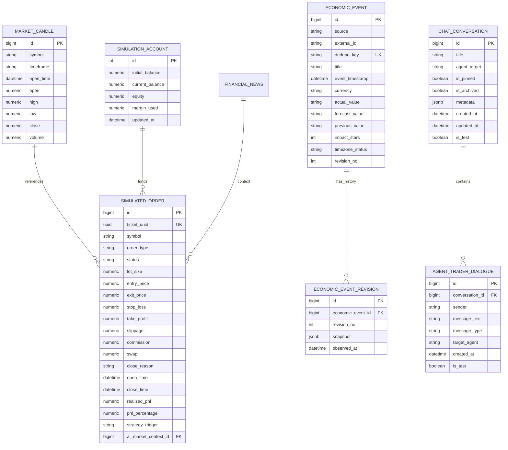

# TECHNICAL SYSTEM SPECIFICATION & ARCHITECTURE
# HỆ THỐNG THÔNG SỐ KỸ THUẬT & CÁCH THỨC HOẠT ĐỘNG CÁC CHỨC NĂNG

> **Dự án:** Trading System - Nền tảng Phân tích Kỹ thuật, Lịch kinh tế & Giả lập Thực thi Giao dịch Vàng (XAUUSD / Forex Spot)  
> **Phiên bản hiện tại:** Phase 03 - Sprint 03 (Live Multi-Agent Chat & MT5 Linux Bridge Integration)  
> **Ngày cập nhật:** 2026-10-16  
> **Môi trường hoạt động:** Docker Compose (Linux Containers: Ubuntu/Debian Wine) & Windows Host  

---

## MỤC LỤC
1. [Tổng quan Kiến trúc Hệ thống (System Architecture)](#1-tổng-quan-kiến-trúc-hệ-thống)
2. [Hạ tầng Docker & Cấu hình Cổng Mạng (Infrastructure & Ports)](#2-hạ-tầng-docker--cấu-hình-cổng-mạng)
3. [Luồng Dữ liệu Thị trường & Nạp Nến Real-time (Market Data Pipeline)](#3-luồng-dữ-liệu-thị-trường--nạp-nến-real-time)
4. [Động cơ Khớp lệnh Giả lập (Paper Execution Engine & Worker)](#4-động-cơ-khớp-lệnh-giả-lập)
5. [Động cơ Phân tích Chiến lược SMC / ICT (AI & Strategy Engine)](#5-động-cơ-phân-tích-chiến-lược-smc--ict)
6. [Hệ thống Thu thập Tin tức & Lịch Kinh tế (News & Macro Events Hub)](#6-hệ-thống-thu-thập-tin-tức--lịch-kinh-tế)
7. [Frontend Trading Cockpit & Trực quan hóa Giao diện](#7-frontend-trading-cockpit--trực-quan-hóa-giao-diện)
8. [Hợp đồng Giao tiếp: REST API & WebSocket Protocol](#8-hợp-đồng-giao-tiếp-rest-api--websocket-protocol)
9. [Mô hình Cơ sở Dữ liệu & Migrations (Database Schema)](#9-mô-hình-cơ-sở-dữ-liệu--migrations)
10. [Biến Môi trường & Quy trình Vận hành (Env & Operations)](#10-biến-môi-trường--quy-trình-vận-hành)

---

## 1. TỔNG QUAN KIẾN TRÚC HỆ THỐNG

Hệ thống được thiết kế theo kiến trúc **Modular Monolith** kết hợp **Event-Driven Architecture (Pub/Sub)**, tối ưu cho xử lý dữ liệu tick thị trường tần suất cao (sub-second) và phản hồi thời gian thực qua WebSockets.

```mermaid
flowchart TB
    subgraph Data_Sources["Nguồn Cấp Dữ Liệu Ngoại Vi"]
        MT5Bridge["MT5 Linux Bridge (CHÍNH THỨC)<br/>MetaQuotes-Demo / Wine + mt5linux<br/>Port 5001 (Real Forex Ticks & Spread)"]
        TwelveDataAPI["Twelve Data REST API (DỰ PHÒNG NGOẠI VI)<br/>api.twelvedata.com (XAU/USD Spot Gold)<br/>Rate Limiter 8 req/min + Redis Cache"]
        NewsSources["News & Calendar Feeds<br/>FairEconomy, Kitco, FXStreet, Finnhub"]
    end

    subgraph Backend_Services["Backend Core (FastAPI / Python 3.12)"]
        Streamer["ChartStreamer & CandleAggregator<br/>(Multi-TF: M1, M5, M15, H1, H4, D1)"]
        NewsCollector["NewsCollector Worker<br/>(Dedupe, Circuit Breaker, 1-3 Stars)"]
        PaperWorker["PaperEngineWorker<br/>(SL/TP Tick Scanner, Real PnL)"]
        SMCEngine["SMC / ICT Strategy Module<br/>(BOS, CHoCH, OB, FVG, Kill Zones)"]
        ChatEngine["Multi-Agent Chat Service<br/>(Sentinel, Vector, Scribe, Arbiter)"]
        WSHub["WebSocket Hub<br/>(/api/v1/ws/market)"]
        RESTHub["REST API Controllers<br/>(/api/v1/market, orders, news, chat, knowledge)"]
    end

    subgraph State_Bus["Message Broker & Caching Layer"]
        RedisPubSub[("Redis 7 Alpine<br/>Channels: market:ticks, paper:orders, news:events, agent:trader:dialogue")]
    end

    subgraph Storage_Layer["Persistent Storage"]
        Postgres[("PostgreSQL 16 Alpine + pgvector<br/>market_candles, simulated_orders, chat_conversations,<br/>standardized_trading_strategies, economic_events")]
    end

    subgraph Frontend_App["Frontend Client (Vue 3 + Vite + Tailwind + Lightweight Charts)"]
        Cockpit["Trading Cockpit View<br/>(TV Chart, Orders Table, Market Analysis)"]
        ChatStudio["AI Chat Studio View (Gemini Layout)<br/>(Multi-Session, Agent Personas)"]
        GlobalPopup["Global Chat Pop-up Widget<br/>(Floating Quick Override & Approvals)"]
        StrategyView["Strategy & Analysis View<br/>(Standardized Strategies Ingestion)"]
        NewsView["News & Events View"]
    end

    MT5Bridge -->|HTTP Poll /ticks/since (Primary 250ms)| Streamer
    TwelveDataAPI -.->|Emergency REST fallback (1 req/min)| Streamer
    NewsSources -->|polling / RSS / JSON| NewsCollector

    Streamer -->|publish 'market:ticks'| RedisPubSub
    Streamer -->|upsert OHLCV| Postgres

    NewsCollector -->|publish 'news:events'| RedisPubSub
    NewsCollector -->|upsert news/events| Postgres

    RedisPubSub -->|subscribe 'market:ticks'| PaperWorker
    PaperWorker -->|execute close / update| Postgres
    PaperWorker -->|publish 'paper:orders'| RedisPubSub

    ChatEngine <-->|Pub/Sub dialogue| RedisPubSub
    ChatEngine <-->|CRUD sessions & messages| Postgres

    RedisPubSub -->|subscribe all channels| WSHub
    WSHub -->|WebSocket push frame| Frontend_App
    Frontend_App -->|REST API calls| RESTHub
    RESTHub -->|query / write| Postgres
    RESTHub -->|evaluate SMC| SMCEngine
    RESTHub -->|chat orchestration| ChatEngine
```

---

## 2. HẠ TẦNG DOCKER & CẤU HÌNH CỔNG MẠNG

Toàn bộ hệ thống được cô lập và chạy trên cùng một bridge network nội bộ `trading-net`:

| Container Name | Service Name | Base Image / Build | Cổng Host (Mapped) | Cổng Nội bộ | Trách nhiệm chính |
| :--- | :--- | :--- | :--- | :--- | :--- |
| `trading_postgres` | `postgres` | `pgvector/pgvector:pg16` | `5432` | `5432` | Cơ sở dữ liệu quan hệ & vector lưu nến, lệnh, tài khoản, tin tức, chat conversations, vector embeddings. Volume: `pgdata`. |
| `trading_redis` | `redis` | `redis:7-alpine` | `6379` | `6379` | Message broker Pub/Sub kênh `market:ticks`, `paper:orders`, `news:events`, `agent:trader:dialogue`. Volume: `redisdata`. |
| `trading_backend` | `backend` | `./backend/Dockerfile` (Python 3.12) | `8000` | `8000` | FastAPI server REST + WebSocket + Multi-Agent Dialogue + 3 background workers (`chart-streamer`, `paper-worker`, `news-collector`). |
| `trading_frontend` | `frontend` | `./frontend/Dockerfile` (Nginx Alpine) | `3000` | `80` | Nginx reverse-proxy & phục vụ Vue 3 production SPA build (`dist/`). |
| `trading_mt5_wine` | `mt5-wine-server` | `lprett/mt5linux:latest` (**Wine + Xvfb + MT5 Terminal**) | `18812`, `8080` | `18812`, `8080` | **Tầng Wine Runtime chuyên biệt:** Chạy MT5 Terminal (`terminal64.exe`) ngầm qua Wine + Xvfb. Khởi động `mt5server.exe` (RPyC server) lắng nghe cổng `18812`. noVNC web GUI trên cổng `8080`. Volume: `mt5data` (persist Wine prefix). |
| `trading_mt5_bridge` | `mt5-bridge` | `./mt5-bridge/Dockerfile` (Python 3.12 + `mt5linux`) | `5001` | `5001` | **FastAPI HTTP Gateway:** Kết nối đến `mt5-wine-server:18812` qua `mt5linux` RPyC client. Cung cấp REST API `/health`, `/account`, `/ticks`, `/candles` cho backend. |
| `trading_tunnel` | `tunnel` | `cloudflare/cloudflared:latest` | N/A | N/A | Cloudflare Tunnel phục vụ public URL bảo mật cho người dùng truy cập từ xa. |

---

## 3. LUỒNG DỮ LIỆU THỊ TRƯỜNG & NẠP NẾN REAL-TIME

### 3.1. Nguồn Cấp Dữ Liệu Chuẩn Forex: MT5 Linux Bridge & Đánh Giá Tính Khả Thi Thay Thế Binance API

#### A. Bất cập cốt lõi của Binance API (PAXGUSDT) đối với thị trường Forex Vàng XAUUSD
Trước đây, hệ thống sử dụng cặp `PAXGUSDT` từ Binance Spot làm nguồn cấp dữ liệu giả định cho `XAUUSD`. Tuy nhiên, qua quá trình vận hành thực tế tại Phase 02 và đầu Phase 03, phương án này bộc lộ những sai lệch nghiêm trọng không thể dung hòa với đặc thù thị trường Forex:
1. **Lệch pha chu kỳ thời gian (24/7 Crypto vs 24/5 Forex Interbank):**
   - Thị trường Forex / Vàng giao ngay (Spot XAUUSD) thế giới hoạt động theo phiên liên ngân hàng quốc tế: Mở cửa lúc 17:00 NY Chủ Nhật (04:00/05:00 sáng Thứ Hai giờ VN) và đóng cửa lúc 17:00 NY Thứ Sáu (04:00/05:00 sáng Thứ Bảy giờ VN). Thứ Bảy và Chủ Nhật toàn bộ các ngân hàng trung ương và sàn giao dịch kim loại quý (London Bullion Market, COMEX) nghỉ hoàn toàn.
   - Binance là sàn Crypto hoạt động liên tục **24/7/365**. Vào hai ngày cuối tuần, Binance PAXGUSDT vẫn tiếp tục khớp lệnh và sinh nến M1–D1. Khối lượng cuối tuần cực kỳ mỏng manh và bị chi phối bởi các bot bán lẻ crypto, tạo ra các cây nến "rác" (choppy wicks) làm biến dạng hoàn toàn các chỉ báo kỹ thuật cốt lõi:
     - Làm méo mó đường trung bình động (EMA 20, EMA 50) và dải biến động thực tế (ATR 14).
     - **Triệt tiêu hiện tượng Khoảng trống giá Mở tuần (Weekend Gap):** Trong Forex, chênh lệch giữa giá đóng cửa Thứ Sáu và mở cửa Thứ Hai phản ánh các biến cố địa chính trị vĩ mô cuối tuần (tin chiến sự, bầu cử, họp G7). Nến chạy 24/7 của Binance triệt tiêu hoàn toàn Weekend Gap, làm mất đi các setup giao dịch Wyckoff/SMC kinh điển.
2. **Phá vỡ cấu trúc Phiên giao dịch & Khung giờ Vàng (Kill Zones Mismatch):**
   - Hệ thống chiến lược SMC/ICT trong `ai_engine/sessions.py` dựa trên các phiên: **Asian Range** (07:00–13:00 ICT), **London Kill Zone** (13:00–16:00 ICT) và **New York AM Kill Zone** (18:00–21:00 ICT).
   - Nến Binance chạy vào thứ Bảy và Chủ Nhật không có phiên London hay New York thực tế, dẫn đến việc động cơ SMC nhận diện nhầm các điểm Swing High / Swing Low giả mạo và kích hoạt tín hiệu sai.
3. **Cơ chế Spread & Chi phí Giao dịch Không Thực Tế:**
   - Binance không có khái niệm Spread thả nổi (Floating Spread) theo thanh khoản ngân hàng. Hệ thống cũ buộc phải sử dụng công thức "Synthetic ECN Spread" nhân tạo (20 points cố định).
   - Trong thực tế, spread XAUUSD co hẹp trong phiên London/NY (10–18 points) và giãn rộng dữ dội vào thời điểm giao phiên (Rollover 17:00 NY) hoặc khi công bố tin tức 3 sao (CPI, NFP có thể giãn lên 40–80 points). Việc thiếu spread thực tế làm sai lệch hoàn toàn thuật toán quét SL/TP của Paper Trading Engine.
4. **Quy chuẩn Hợp đồng & Đòn bẩy:**
   - Binance PAXG tính theo token coin (1 PAXG = 1 oz), phí tính theo USDT Maker/Taker, không có Swap qua đêm (Rollover / Triple Swap vào Thứ Tư).
   - MetaTrader 5 chuẩn hóa hợp đồng Forex Hedged: 1 Lot = 100 Troy Oz, đòn bẩy linh hoạt (1:100), tính Margin, Free Margin và Swap thực tế.

#### B. Giải pháp Kỹ thuật: Cầu Nối MetaTrader 5 trên Linux (`trading_mt5_bridge`)
Để khắc phục triệt để các hạn chế trên, hệ thống chuyển dịch toàn diện sang sử dụng tài khoản Demo MetaQuotes trên nền tảng MetaTrader 5 chạy trong container Linux.

1. **Cơ sở Kỹ thuật: MetaTrader 5 trên Linux qua Wine:**
   - Theo tài liệu chính thức từ MetaQuotes ([MetaTrader 5 Installation on Linux](https://www.metatrader5.com/en/terminal/help/start_advanced/install_linux)), nền tảng MetaTrader 5 hoạt động ổn định trên môi trường Linux (Ubuntu/Debian) thông qua lớp tương thích **Wine (WineHQ)**. MetaQuotes cung cấp script tự động hóa chính thức `https://download.terminal.free/cdn/web/metaquotes.software.corp/mt5/mt5linux.sh`.
2. **Kiến trúc Đóng gói Docker Container với `mt5linux`:**
   - Do thư viện Python chính thức `MetaTrader5` từ MetaQuotes chỉ phát hành bản binary wheel (`.whl`) dành riêng cho Windows runtime (`terminal64.exe`), phương án đóng gói container Linux tối ưu áp dụng kiến trúc cầu nối RPC **`mt5linux`** (thư viện mã nguồn mở chuyên dụng cho Linux/Docker):
     - **Tầng 1 (Wine & Headless Display):** Container Linux (Ubuntu 22.04 LTS) tích hợp `winehq-stable` và `Xvfb` (X Virtual Framebuffer). Cho phép `terminal64.exe` chạy ngầm 100% không cần màn hình vật lý.
     - **Tầng 2 (Windows Python Engine trong Wine):** Bên trong môi trường Wine, cài đặt phiên bản Python for Windows và thư viện `MetaTrader5` chính thức.
     - **Tầng 3 (RPC Server - RPyC):** Khởi chạy một tiến trình RPyC Server ngầm lắng nghe cổng nội bộ `18812`.
     - **Tầng 4 (FastAPI HTTP Microservice):** File `mt5-bridge/server.py` kết nối với `MetaTrader5` qua RPC `mt5linux`, cung cấp các endpoint REST HTTP siêu tốc (`/health`, `/account`, `/ticks/{symbol}`, `/ticks/{symbol}/since`) trên cổng `5001`.
3. **Cấu hình Tài khoản Demo MetaQuotes Độc lập:**
   - **Tên chủ tài khoản:** `Nguyen Dinh Dung`
   - **Máy chủ (Server):** `MetaQuotes-Demo`
   - **Loại tài khoản (Type):** `Forex Hedged USD`
   - **Mã đăng nhập (Login ID):** `5057446983`
   - **Mật khẩu giao dịch (Master Password):** `FxN@6nZf`
   - **Mật khẩu nhà đầu tư (Investor/Read-only):** `_g0bGwTk`
   - **Cặp giao dịch:** `XAUUSD` (Spot Gold vs US Dollar, 1 lot = 100 oz, khớp lệnh Hedging).
4. **Đánh giá Tính Khả Thi Kỹ Thuật (Feasibility Matrix):**

| Tiêu Chí Đánh Giá | Binance API (PAXGUSDT) | MT5 Linux Bridge (MetaQuotes Demo) | Kết Luận & Đánh Giá Khả Thi |
| :--- | :--- | :--- | :--- |
| **Giờ Giao Dịch** | 24/7/365 (Bị nhiễu cuối tuần) | 24/5 (Chính xác theo phiên quốc tế) | **VƯỢT TRỘI**: Bảo toàn Weekend Gap và cấu trúc phiên SMC. |
| **Dữ Liệu Spread** | Cố định 20 points (Synthetic) | Thả nổi thực tế từ Liquidity Providers | **VƯỢT TRỘI**: Phản ánh đúng giãn spread lúc tin tức và rollover. |
| **Độ Sâu & Khối Lượng** | Pool Crypto nhỏ lẻ | Báo giá chuẩn liên ngân hàng | **VƯỢT TRỘI**: Tick volume phản ánh đúng động lượng Smart Money. |
| **Độ Trễ (Latency)** | WS WebSocket ~80–120ms | REST Internal Docker ~1.2ms, Poll 250ms | **RẤT TỐT**: Độ trễ nội bộ Docker network gần như tức thời. |
| **Tài Nguyên (RAM/CPU)** | Nhẹ (~50MB) | Tiêu thụ ~350MB–450MB RAM, CPU < 2% | **KHẢ THI 100%**: Hoàn toàn nằm trong ngân sách tài nguyên VPS/Docker. |
| **Tương Thích Backend** | Đang chạy | Backend `MT5Feed` đã tích hợp sẵn 100% | **HOÀN THÀNH NGAY**: Không phát sinh chi phí refactor luồng dữ liệu. |

#### C. Kiến Trúc 2-Container MT5 (Phase 03 Sprint 03 — Giải pháp Triển khai Thực tế)

Qua nghiên cứu kỹ thuật chuyên sâu (tham chiếu: [MetaTrader 5 on Linux — MetaQuotes Official Docs](https://www.metatrader5.com/en/terminal/help/start_advanced/install_linux), [lucas-campagna/mt5linux GitHub](https://github.com/lucas-campagna/mt5linux)), vấn đề gốc rễ của kết nối MT5 trên môi trường Linux là:

> **`mt5linux` (thư viện Python Linux client) KHÔNG tự chứa MT5 Terminal hay Wine.** Nó chỉ là client RPyC kết nối đến một `mt5server.exe` đang chạy bên trong Wine. Nếu không có Wine server riêng, RPyC luôn thất bại với `ConnectionRefusedError: [Errno 111]`.

Giải pháp: Tách thành **2 container chuyên biệt**, mỗi container đảm nhiệm đúng 1 tầng:

```
┌─────────────────────────────────────────────────────────────┐
│                    Docker Network: trading-net               │
│                                                             │
│  ┌─────────────────────────┐      ┌────────────────────┐   │
│  │   trading_mt5_wine      │      │  trading_mt5_bridge │   │
│  │   lprett/mt5linux:latest│      │  ./mt5-bridge/      │   │
│  │                         │      │  (Python + mt5linux) │   │
│  │  Wine (WineHQ Stable)   │      │                    │   │
│  │  Xvfb (Virtual Display) │      │  FastAPI HTTP       │   │
│  │  terminal64.exe (MT5)   │─────▶│  :5001             │   │
│  │  mt5server.exe (RPyC)   │18812 │                    │   │
│  │  noVNC GUI  :8080       │      │  REST endpoints:   │   │
│  └─────────────────────────┘      │  /health /account  │   │
│                                   │  /ticks  /candles  │   │
│                                   └────────────────────┘   │
└─────────────────────────────────────────────────────────────┘
```

**Docker Image `lprett/mt5linux:latest`** (chính thức từ dự án `lucas-campagna/mt5linux`):
- **Tag `latest`:** Image nền đã cài Wine + Xvfb + noVNC, **chưa cài MT5**. Lần đầu chạy sẽ tự động tải và cài MT5 Terminal qua Wine.
- **Tag `mt5-installed`:** Image đã tích hợp sẵn MT5 Terminal → thời gian khởi động nhanh hơn đáng kể (khuyến nghị cho production).
- **Environment Variables bắt buộc:**
  - `MT5_HOST=0.0.0.0` → Cho phép RPyC bind ra tất cả interface (để `mt5-bridge` kết nối qua Docker network)
  - `MT5_LOGIN`, `MT5_PASSWORD`, `MT5_SERVER` → Credentials tài khoản MetaQuotes-Demo
  - `VNC_PASSWORD` → Mật khẩu bảo vệ noVNC web console

#### D. Hướng Dẫn Khởi Động & Kiểm Thử Kết Nối MT5 Bridge

**Lưu ý quan trọng:** `trading_mt5_wine` cần **2–5 phút** khởi động lần đầu để Wine hoàn tất cài đặt MT5 Terminal. Các lần khởi động tiếp theo từ volume `mt5data` chỉ cần **15–30 giây**.

```powershell
# Bước 1: Kéo về và khởi động toàn bộ cụm (bao gồm mt5-wine-server)
docker compose pull mt5-wine-server
docker compose up -d --build

# Bước 2: Theo dõi tiến trình khởi động Wine & MT5 Terminal
docker logs -f trading_mt5_wine
# Đợi đến khi thấy: "mt5server started on port 18812" hoặc tương tự

# Bước 3: Kiểm tra RPyC đang lắng nghe trên port 18812
docker exec trading_mt5_wine nc -z localhost 18812 && echo "RPyC OK" || echo "RPyC NOT READY"

# Bước 4: Kiểm tra kết nối từ phía mt5-bridge
docker logs trading_mt5_bridge
curl http://localhost:5001/health

# Bước 5: Kích hoạt kết nối lại từ Settings UI hoặc REST API
curl -X POST http://localhost:8000/api/v1/market/mt5/reconnect

# Bước 6: Kiểm tra trạng thái tài khoản MetaQuotes-Demo
curl http://localhost:5001/account

# Truy cập noVNC để xem giao diện MT5 Terminal trực quan (tùy chọn)
# → http://localhost:8080  (Password: trading123)
```

#### E. Xử Lý Sự Cố Kết Nối Wine/RPyC (Troubleshooting Matrix)

| Triệu Chứng | Nguyên Nhân | Hành Động Khắc Phục |
| :--- | :--- | :--- |
| `Connection refused: 18812` trong `mt5-bridge` logs | `mt5-wine-server` chưa hoàn tất khởi động | Đợi thêm 2–3 phút. Chạy lại `POST /reconnect`. Kiểm tra `docker logs trading_mt5_wine`. |
| `mt5-wine-server` không xuất hiện trong `docker ps` | Image chưa được pull hoặc port 8080/18812 bị chiếm | Chạy `docker compose pull mt5-wine-server` và `docker compose up mt5-wine-server`. |
| `initialize() failed: Error 10019` trong MT5 Bridge | Sai `MT5_SERVER` hoặc `MT5_LOGIN`/`MT5_PASSWORD` | Kiểm tra biến môi trường. Verify credentials tại [MetaQuotes Demo](https://demo.mt5.com/). |
| MT5 Terminal hiển thị "Account Disabled" trên noVNC | Tài khoản Demo MetaQuotes hết hạn (30 ngày không hoạt động) | Đăng ký tài khoản Demo mới tại [www.metatrader5.com](https://www.metatrader5.com) và cập nhật biến môi trường. |
| `copy_rates_from` trả về `None` dù kết nối thành công | Symbol `XAUUSD` chưa được thêm vào Market Watch | Trong noVNC, mở MT5 Terminal → Market Watch → Chuột phải → Show All → tìm và chọn `XAUUSD`. |
| Container `trading_mt5_wine` khởi động liên tục (restart loop) | Wine prefix bị hỏng hoặc không tương thích | Xóa volume `mt5data`: `docker volume rm xau_mt5data` rồi khởi động lại để Wine re-initialize. |

---

### 3.2. Bộ tổng hợp nến đa khung thời gian (`CandleAggregator`)
Hỗ trợ đầy đủ **6 khung thời gian**:
1. **M1** (1 phút / 60 giây)
2. **M5** (5 phút / 300 giây)
3. **M15** (15 phút / 900 giây) - *Khung trigger vào lệnh SMC*
4. **H1** (1 giờ / 3600 giây) - *Khung Dealing Range & POI*
5. **H4** (4 giờ / 14400 giây) - *Khung HTF Bias*
6. **D1** (1 ngày / 86400 giây) - *Khung HTF Bias*

* **Quy tắc tổng hợp (Aggregation Rules):**
  * Xác định mốc nến bắt đầu: $\text{bucket} = \text{timestamp\_seconds} - (\text{timestamp\_seconds} \pmod \text{seconds})$.
  * Khi nến mới bắt đầu: khởi tạo `open = bid`, `high = bid`, `low = bid`, `close = bid`, `volume = traded_volume`.
  * Trong thời gian nến chạy: cập nhật $\text{high} = \max(\text{high}, bid)$, $\text{low} = \min(\text{low}, bid)$, $\text{close} = bid$, cộng dồn `volume`.
  * Khử trùng lặp tick (Tick Deduplication): Sử dụng `deque` trượt 4,096 ticks để lọc các tick trùng lặp miligiây.

### 3.3. Cơ chế Khởi tạo & Nạp nến lịch sử (Historical Seeding Pipeline)
Khi khởi động hệ thống hoặc khi frontend chuyển sang khung thời gian bất kỳ (ví dụ H4, D1), nếu DB chưa có đủ nến:
* Endpoint `GET /api/v1/market/history` tự động kích hoạt nạp nến lịch sử:
  * **Nguồn ưu tiên 1 (MT5 Linux Bridge):** Gọi `terminal.copy_rates_from_pos(symbol, timeframe, 0, 500)` để trích xuất 500 nến chuẩn lịch sử trực tiếp từ máy chủ MetaQuotes-Demo.
  * **Nguồn dự phòng 2 (Twelve Data REST API):** Gọi `https://api.twelvedata.com/time_series?symbol=XAU/USD&interval={interval}&outputsize=500&timezone=UTC` làm nguồn hạt giống dự phòng khi MT5 bridge chưa kết nối hoặc không phản hồi.
  * Thực hiện câu lệnh PostgreSQL `ON CONFLICT (symbol, timeframe, open_time) DO UPDATE` để ghi đè hoặc bổ sung 500 nến chuẩn vào bảng `market_candles`.
  * Trả về ngay lập tức cho biểu đồ mà không gây nến rỗng (blank chart).

### 3.4. Hệ thống Dự phòng Dữ liệu Ngoại vi: Twelve Data API (`twelvedata.com`)
Nhằm thay thế hoàn toàn nguồn fallback Binance cũ (vốn dùng token PAXGUSDT với độ trễ và spread nhân tạo), hệ thống đã tích hợp chính thức **Twelve Data API** chuyên dụng cho vàng giao ngay quốc tế:

1. **Cấu hình Symbol & Khung Thời Gian:**
   * **Symbol chuẩn hóa:** `XAU/USD` (Spot Gold vs US Dollar theo chuẩn liên ngân hàng).
   * **Bảng ánh xạ Timeframes:**
     * `M1` $\to$ `1min`
     * `M5` $\to$ `5min`
     * `M15` $\to$ `15min`
     * `H1` $\to$ `1h`
     * `H4` $\to$ `4h`
     * `D1` $\to$ `1day`
2. **Bộ Quản lý Giới hạn Tần suất (Rate Limit Handler):**
   * **Hạn ngạch gói Free:** Tối đa **8 requests / phút** và **800 requests / ngày**.
   * **Cơ chế kiểm soát (`TwelveDataRateLimiter`):** Sử dụng Redis Pipeline Atomic (`twelve_data:quota:min:{min_key}` và `twelve_data:quota:day:{day_key}`) để theo dõi quota thời gian thực.
   * **Tự động chờ (Backoff):** Nếu chạm 8 req/phút, hệ thống tự động sleep đến chu kỳ phút tiếp theo ($60 - \text{now} \pmod{60} + 0.5s$) trước khi phát request. Nếu Redis gián đoạn, tự động chuyển về in-memory counter.
3. **Cơ chế Retry & Exponential Backoff:**
   * Mỗi request được bọc trong vòng lặp tối đa 3 lần thử.
   * Khi gặp HTTP 429 hoặc lỗi kết nối, tính toán thời gian chờ tăng lũy tiến: $\text{delay} = 2^{\text{attempt}} + \text{jitter}$ (từ 2.0s đến 8.0s).
4. **Tầng Bộ nhớ Đệm Redis Caching (TTL $\ge$ 60s):**
   * Khóa cache: `twelve_data:cache:{symbol}:{interval}:{outputsize}:{start_date}:{end_date}`.
   * **TTL linh hoạt:** M1 (60s), M5 (180s), M15 (300s), H1 (900s), H4 (1800s), D1 (3600s).
   * Cache Hit trả về ngay kết quả mà **không tiêu tốn hạn ngạch** gọi API Twelve Data.
5. **Chuẩn hóa Định dạng Thời gian & Thứ tự Biểu đồ:**
   * Twelve Data trả về chuỗi datetime dạng `YYYY-MM-DD HH:MM:SS` (nến trong ngày) hoặc `YYYY-MM-DD` (nến ngày D1).
   * Được ép múi giờ `timezone=UTC` khi gọi API và chuyển đổi thành **Unix timestamp theo giây** (`int(dt.timestamp())`) tương thích 100% với TradingView Lightweight Charts trên frontend và cột `MarketCandle.open_time`.
   * Đảo ngược thứ tự trả về từ **Reverse Chronological (Mới nhất trước)** sang **Chronological (Cũ nhất trước)** để biểu đồ hiển thị liên tục, mượt mà từ trái sang phải.
6. **Vá Lỗ Hổng Nến Tự Động (`CandleGapHealer`):**
   * Tự động phát hiện Trailing Gaps và Internal Gaps khi có sự cố downtime máy chủ.
   * Ưu tiên vá nến từ MT5 Bridge; nếu MT5 ngắt kết nối, tự động chuyển sang Twelve Data API để bù đắp các khoảng trống dữ liệu với nhãn `data_source = 'twelvedata'`.

---

## 4. ĐỘNG CƠ KHỚP LỆNH GIẢ LẬP (PAPER EXECUTION ENGINE)

Module `PaperEngine` (`simulation/paper_engine.py`) và `PaperEngineWorker` (`simulation/paper_worker.py`) chạy nền liên tục.

### 4.1. Quy tắc mở lệnh (Order Fill)
* Lệnh **BUY**: Khớp theo giá **Ask** cộng trượt giá (Slippage):
  $$\text{Entry}_{\text{BUY}} = \text{Ask} + \text{Slippage}$$
  * Điều kiện hợp lệ: $\text{Stop Loss} < \text{Entry} < \text{Take Profit}$.
* Lệnh **SELL**: Khớp theo giá **Bid** trừ trượt giá (Slippage):
  $$\text{Entry}_{\text{SELL}} = \text{Bid} - \text{Slippage}$$
  * Điều kiện hợp lệ: $\text{Take Profit} < \text{Entry} < \text{Stop Loss}$.
* **Tham số mặc định:**
  * Contract Size: `100.0` (1 lot XAUUSD = 100 Troy Oz).
  * Slippage Points: `1.0 point` ($0.01 USD).
  * Commission: `$0.00` (có thể cấu hình trong Settings).

### 4.2. Cơ chế Quét SL/TP Tick-by-Tick
Worker lắng nghe channel Redis `market:ticks` (chỉ quét trên tick M1 để tránh lặp lại 6 lần):
* Với vị thế **BUY**:
  * Thoát lệnh tại giá **Bid**:
    * Chạm Stop Loss: $\text{Bid} \le \text{Stop Loss} \implies \text{Close Reason} = \text{"SL\_HIT"}$
    * Chạm Take Profit: $\text{Bid} \ge \text{Take Profit} \implies \text{Close Reason} = \text{"TP\_HIT"}$
* Với vị thế **SELL**:
  * Thoát lệnh tại giá **Ask**:
    * Chạm Stop Loss: $\text{Ask} \ge \text{Stop Loss} \implies \text{Close Reason} = \text{"SL\_HIT"}$
    * Chạm Take Profit: $\text{Ask} \le \text{Take Profit} \implies \text{Close Reason} = \text{"TP\_HIT"}$

### 4.3. Công thức tính Lợi nhuận / Thua lỗ (PnL)
$$\text{Realized PnL} = (\text{Exit Price} - \text{Entry Price}) \times \text{Direction} \times \text{Lots} \times 100$$
*(Trong đó: Direction = +1 cho BUY, -1 cho SELL)*

$$\text{PnL Percentage} = \frac{\text{Exit Price} - \text{Entry Price}}{\text{Entry Price}} \times 100 \times \text{Direction}$$

### 4.4. Quản lý Tài khoản Mô phỏng (`SimulationAccount`)
* Vốn ban đầu: `$10,000.00 USD`.
* Khi đóng lệnh:
  $$\text{Current Balance} \leftarrow \text{Current Balance} + \text{Realized PnL}$$
  $$\text{Equity} = \text{Current Balance} + \sum \text{Unrealized PnL}$$
  $$\text{Free Margin} = \text{Equity} - \text{Margin Used}$$
* Phát sự kiện WebSocket `order.update` với `event: "ORDER_CLOSED"` đến client ngay lập tức.

---

## 5. ĐỘNG CƠ PHÂN TÍCH CHIẾN LƯỢC SMC / ICT (AI & STRATEGY ENGINE)

Module `ai_engine` chứa các nguyên thủy Smart Money Concepts (SMC) và Inner Circle Trader (ICT) dạng **rule-based, 100% không look-ahead**.

### 5.1. Định nghĩa Toán học các Nguyên thủy SMC (`ai_engine/smc.py`)
1. **Fractal Swing High / Low:**
   * Cấu hình mặc định: $\text{left} = 3, \text{right} = 3$.
   * Một đỉnh chỉ được xác nhận là Swing High khi giá High tại nến $j$ là lớn nhất trong cửa sổ $2 \times 3 + 1 = 7$ nến:
     $$h_j = \max_{k=j-3}^{j+3}(h_k)$$
   * Tín hiệu chỉ được tính tại thời điểm $i \ge j + \text{right} = j + 3$ (ngăn ngừa tuyệt đối lỗi look-ahead bias).
2. **Break of Structure (BOS) & Change of Character (CHoCH):**
   * Điều kiện kích hoạt: Giá **ĐÓNG CỬA** ($Close$) vượt qua mức Swing gần nhất ($Close > Swing High$ hoặc $Close < Swing Low$).
   * Nếu nến phá vỡ cùng hướng xu hướng trước đó: **BOS** (tiếp diễn cấu trúc).
   * Nếu nến phá vỡ ngược hướng xu hướng trước đó: **CHoCH** (đảo chiều cấu trúc).
3. **Dealing Range & 50% Equilibrium:**
   * Đo khoảng cách giữa Swing High gần nhất ($H$) và Swing Low gần nhất ($L$):
     $$\text{Equilibrium} = \frac{H + L}{2}$$
   * Phân vùng:
     * $\text{Price} < \text{Equilibrium} \implies \mathbf{DISCOUNT}$ (Chỉ tìm cơ hội MUA).
     * $\text{Price} \ge \text{Equilibrium} \implies \mathbf{PREMIUM}$ (Chỉ tìm cơ hội BÁN).
4. **Fair Value Gap (FVG):**
   * Khoảng trống giá hình thành qua mô hình 3 nến liên tiếp:
     * Bullish FVG: $Low_3 > High_1$ với khoảng cách $Low_3 - High_1 \ge 0.3 \times \text{ATR}(14)$.
     * Bearish FVG: $High_3 < Low_1$ với khoảng cách $Low_1 - High_3 \ge 0.3 \times \text{ATR}(14)$.
5. **Order Block (OB):**
   * Nến ngược hướng cuối cùng tại đáy/đỉnh của chặng displacement (sóng đẩy mạnh) tạo ra BOS hoặc CHoCH.
6. **Liquidity Sweeps (Quét thanh khoản):**
   * Giá có bấc nến vượt qua Swing Level nhưng giá **ĐÓNG CỬA** rút chân quay trở lại bên trong phạm vi.

### 5.2. Khung Giờ Vàng Giao dịch (Kill Zones - `ai_engine/sessions.py`)
Hệ thống sử dụng thư viện `zoneinfo` để tự động bù trừ giờ mùa hè/mùa đông (DST - Daylight Saving Time) theo chuẩn giờ New York (`America/New_York`):

| Tên Phiên / Kill Zone | Khung Giờ New York (EDT/EST) | Giờ Việt Nam (ICT = UTC+7, DST Summer) | Giờ Việt Nam (ICT, Winter) | Đặc điểm giao dịch |
| :--- | :--- | :--- | :--- | :--- |
| **London Kill Zone** | 02:00 – 05:00 NY | 13:00 – 16:00 ICT | 14:00 – 17:00 ICT | Tạo đỉnh/đáy phiên Á, xác lập hướng trong ngày. |
| **New York AM Kill Zone** | 07:00 – 10:00 NY | 18:00 – 21:00 ICT | 19:00 – 22:00 ICT | Thanh khoản cao nhất, đón tin CPI/NFP/FOMC. |
| **New York PM Kill Zone** | 13:30 – 16:00 NY | 00:30 – 03:00 ICT | 01:30 – 04:00 ICT | Đảo chiều phiên chiều hoặc chốt phiên Mỹ. |
| **Asia Session** | 20:00 – 02:00 NY | 07:00 – 13:00 ICT | 08:00 – 14:00 ICT | Tích lũy biên độ hẹp (Asian Range). |
| **Silver Bullet** | 03:00–04:00, 10:00–11:00, 14:00–15:00 NY | Các khung 1 tiếng thanh khoản cao điểm | Quét FVG và tìm nhịp hồi 1R:2R nhanh. |

### 5.3. Quy trình Phân tích Chiến lược Đa khung (Multi-Timeframe Pipeline)
Quy trình thực thi theo 3 tầng nghiêm ngặt (`ai_engine/strategy.py`):
1. **Tầng 1 - HTF Bias (D1 & H4):** Xác định xu hướng vĩ mô qua Fractal Swing. Bắt buộc D1 và H4 phải đồng thuận xu hướng (`b4 == b1`).
2. **Tầng 2 - POI Selection (H1):** Xác định Dealing Range và Equilibrium. Chỉ chọn POI (OB hoặc FVG) nằm sâu trong vùng Discount (nếu Long) hoặc Premium (nếu Short).
3. **Tầng 3 - Trigger & Entry (M15):** 
   * Kiểm tra nến M15 đã chạm vào vùng POI H1 (`tap POI`).
   * Nến M15 đóng cửa tạo **CHoCH** xác nhận đổi cấu trúc.
   * Thời điểm diễn ra phải nằm trong cửa sổ **Kill Zone**.
   * Tính Stop Loss: Đáy vùng tích lũy trừ đi phần đệm $0.5 \times \text{ATR}(15)$.
   * Tính Take Profit: Mục tiêu đỉnh Swing High đối diện với tỷ lệ Risk:Reward $\ge 1:2.0$.

### 5.4. API Phân tích Thị trường (`GET /api/v1/market/analysis`)
Trả về cấu trúc phân tích động:
* **HTF Trend:** Trạng thái đồng thuận D1/H4, Swing High, Swing Low.
* **Intraday Trend:** Vùng Discount/Premium H1, con trỏ giá hiện tại so với Equilibrium.
* **Kịch bản đề xuất (Scenarios):**
  * *Primary Scenario (65% xác suất):* Mua thuận xu hướng tại vùng POI Discount.
  * *Alternative Scenario (35% xác suất):* Dự phòng nhịp quét Sell-Side Liquidity khi thủng mốc SL.
* **Predicted Setup:** Entry Zone, Entry Price, SL, TP, Risk:Reward, trạng thái `WAITING_TRIGGER`.
* **Invalidation Criteria:** 4 quy tắc hủy kịch bản (Thủng POI, Tin đỏ 3 sao ra trong 30p, Hết Kill Zone, R:R < 1:2.0).

---

## 6. HỆ THỐNG THU THẬP TIN TỨC & LỊCH KINH TẾ (NEWS & MACRO EVENTS HUB)

Module `NewsCollector` (`data_ingestion/news_worker.py`) chạy nền với chu kỳ polling định kỳ.

### 6.1. Bốn Nguồn Cung cấp Dữ liệu
1. **FairEconomy Calendar (JSON):** Nguồn chính cho Lịch kinh tế (`ff_calendar_thisweek.json`), cung cấp giờ phát hành, mã tiền tệ, mức độ tác động, số liệu Actual, Forecast, Previous.
2. **Kitco News (RSS XML):** Kênh tin tức chuyên sâu về Vàng thế giới và thị trường kim loại quý.
3. **FXStreet News (RSS XML):** Tin tức ngoại hối, chính sách tiền tệ Fed, nhận định phân tích kỹ thuật.
4. **Finnhub Market News (REST API):** Tin tức thị trường toàn cầu (yêu cầu API Key).

### 6.2. Cơ chế Xử lý & Chuẩn hóa Kỹ thuật
* **Phân loại tác động 1–3 sao:**
  * 3 sao (★★★ Cao / HIGH): CPI, Core CPI, Non-Farm Payrolls (NFP), FOMC Statement, Interest Rate Decision, GDP.
  * 2 sao (★★ Vừa / MEDIUM): Retail Sales, PPI, ISM Manufacturing PMI, Unemployment Claims.
  * 1 sao (★ Thấp / LOW): Các báo cáo phụ và chỉ số khảo sát khu vực.
* **Cơ chế Khử trùng lặp (Deduplication):** Sử dụng hàm băm SHA256 tạo `dedupe_key` dựa trên `source + title + published_at/event_time`.
* **Cơ chế Circuit Breaker & Fallback:**
  * Nếu một nguồn tin lỗi 2 lần liên tiếp $\implies$ Chuyển nguồn sang trạng thái `DEGRADED`, kích hoạt exponential backoff với header `Retry-After`.
  * Sau 2 lần thăm dò thành công liên tiếp $\implies$ Tự động phục hồi về trạng thái `HEALTHY`.
* **Snapshots & Versioning (`economic_event_revisions`):** Mỗi khi cơ quan thống kê điều chỉnh số liệu (ví dụ điều chỉnh Non-Farm tháng trước), hệ thống tăng `revision_no` và lưu snapshot cũ vào bảng revisions.

---

## 7. FRONTEND TRADING COCKPIT & TRỰC QUAN HÓA GIAO DIỆN

Frontend được xây dựng bằng **Vue 3 Composition API**, quản lý trạng thái bằng **Pinia/Reactive Stores**, giao diện Dark Theme Cyberpunk / Quant Trading chuyên nghiệp.

### 7.1. Cấu trúc Điều hướng Đa Màn hình (Main Navigation)
1. **Trading Cockpit:** Màn hình chính phục vụ quan sát thị trường và giao dịch:
   * **Cột trái (70%):** Biểu đồ TradingView Lightweight Charts $\to$ Bảng lệnh đang mở (Paper Positions) $\to$ Khối Phân tích & Kịch bản Thị trường (`MarketAnalysisStatus.vue`).
   * **Cột phải (30%):** Bảng tổng quan AI Insights $\to$ Dòng tin tức & Lịch kinh tế trong ngày (3 tabs Yesterday, Today, Tomorrow).
2. **Orders History:** Bảng tổng kết toàn bộ lệnh đã đóng, bộ lọc nâng cao, thống kê Win Rate, Profit Factor, Realized PnL.
3. **News & Events:** Trung tâm tin tức vĩ mô toàn diện, giám sát trạng thái 4 nguồn tin (Health/Latency), tab Economic Calendar và tab Breaking News.
4. **Strategy & Analysis:** Toàn bộ hệ tri thức SMC, quy trình đa khung thời gian, thư viện khái niệm, ma trận quản trị rủi ro, checklist 7 bước.
5. **Settings & Diagnostics:** Giám sát PostgreSQL/Redis/MT5 Linux Bridge/Twelve Data API, chẩn đoán ping API latency, thiết lập tham số trượt giá, lot size mặc định.

### 7.2. Tối ưu Đồ họa Biểu đồ (`TradingViewChart.vue`)
* **Thư viện:** TradingView Lightweight Charts (v4.x Canvas-based).
* **Đường giá vị thế (Price Lines):**
  * Entry Price: Đường xanh lam nét đứt (`#2962ff`, style 2).
  * Stop Loss: Đường đỏ nét đứt (`#ef5350`, style 2).
  * Take Profit: Đường xanh lá nét đứt (`#26a69a`, style 2).
* **Markers Vào/Đoán/Thoát Lệnh (Mũi tên Tối giản):**
  * Lệnh BUY: Mũi tên xanh ngọc hướng lên (`arrowUp`, `belowBar`, `#26a69a`, size 1).
  * Lệnh SELL & Thoát lệnh BUY (Exit Price): Mũi tên đỏ cam hướng xuống (`arrowDown`, `aboveBar`, `#ef5350`, size 1).
  * **Khử trùng lặp trên nến (Candle-level Deduplication):** Sử dụng cấu trúc `Set` lọc theo timestamp nến đã snap. Nếu một nến có nhiều lệnh (DCA hoặc khớp lệnh cùng lúc), biểu đồ chỉ hiển thị duy nhất **1 mũi tên** cho mỗi chiều.
  * **Thuật toán Snap Nến (Binary Search):** Tự động snap thời gian timestamp của lệnh về đúng `open_time` của cây nến thuộc khung thời gian đang chọn (M1–D1), loại bỏ lỗi assertion failed của Lightweight Charts.

### 7.3. Khối Trạng thái Phân tích Thị trường (`MarketAnalysisStatus.vue`)
* Tích hợp thanh trượt Dealing Range H1 (Low $\to$ 50% Equilibrium $\to$ High) với con trỏ định vị giá live.
* Tích hợp **Dynamic Lot Size Calculator:** Cho phép trader chọn rủi ro (0.5%, 1.0%, 1.5%, 2.0%), tự động tính toán khối lượng Lot chuẩn:
  $$\text{Lot Size} = \frac{\text{Equity} \times \text{Risk \%}}{|\text{Entry} - \text{SL}| \times 100}$$
* Hiển thị chi tiết 4 tiêu chí hủy kịch bản bảo vệ vốn (Invalidation badges).

---

## 8. HỢP ĐỒNG GIAO TIẾP: REST API & WEBSOCKET PROTOCOL

### 8.1. Danh mục Endpoints REST API (Base: `/api/v1` & MT5 Bridge: Port 5001)

#### A. Backend Core Endpoints (`http://backend:8000/api/v1`)
| Phương thức | Endpoint | Tham số Query / Body | Chức năng |
| :--- | :--- | :--- | :--- |
| `GET` | `/health` | Không | Kiểm tra trạng thái hệ thống, ping kết nối DB và Redis. |
| `GET` | `/api/v1/market/history` | `symbol` (str), `timeframe` (str), `limit` (int, 1-5000) | Lấy danh sách nến lịch sử. Tự động seed từ MT5 (hoặc Twelve Data fallback nếu trống). |
| `GET` | `/api/v1/market/analysis` | `symbol` (str) | Lấy dữ liệu phân tích SMC, kịch bản giao dịch, setup dự kiến. |
| `GET` | `/api/v1/orders` | `limit` (int, 1-200) | Lấy danh sách lệnh giả lập (cả lệnh OPEN và CLOSED). |
| `POST` | `/api/v1/orders` | JSON: `symbol`, `order_type`, `lot_size`, `stop_loss`, `take_profit`, `entry_price?` | Đặt lệnh mới qua Paper Trading Engine. |
| `POST` | `/api/v1/orders/{id}/close` | JSON: `reason` (mặc định `"MANUAL_CLOSE"`) | Đóng thủ công một vị thế đang mở theo giá thị trường hiện tại. |
| `GET` | `/api/v1/simulation/account` | Không | Lấy số dư tài khoản, Equity, Margin Used, Free Margin, Open Count. |
| `GET` | `/api/v1/news` | `limit` (int, 1-200) | Lấy danh sách tin tức tức thời kèm điểm tâm lý và số sao. |
| `GET` | `/api/v1/news/events` | `limit` (int, 1-200) | Lấy danh sách sự kiện lịch kinh tế (Actual/Forecast/Prev). |
| `GET` | `/api/v1/news/status` | Không | Trạng thái sức khỏe, số lượt nạp của 4 nguồn tin. |
| `GET` | `/api/v1/chat/conversations` | `is_archived` (bool) | Lấy danh sách phiên hội thoại đa Agent (Gemini layout). |
| `POST` | `/api/v1/chat/conversations/{id}/messages` | JSON: `message`, `target_agent`, `attach_market_context` | Gửi tin nhắn đối thoại với Governor (Arbiter), Vector, Sentinel, Scribe. |

#### B. MT5 Linux Bridge Microservice Endpoints (`http://mt5-bridge:5001`)
| Phương thức | Endpoint | Tham số Query / Body | Chức năng |
| :--- | :--- | :--- | :--- |
| `GET` | `/health` | Không | Kiểm tra kết nối terminal MetaTrader 5, server `MetaQuotes-Demo`, login status. |
| `GET` | `/account` | Không | Lấy thông tin tài khoản demo MT5: Balance, Equity, Leverage, Margin, Currency. |
| `GET` | `/ticks/{symbol}` | Path: `symbol` (`XAUUSD`) | Lấy tick mới nhất gồm Bid, Ask, Spread (points), Volume và Unix timestamp. |
| `GET` | `/ticks/{symbol}/since` | Query: `since_ms` (int timestamp miligiây) | Trích xuất batch ticks mới phát sinh kể từ mốc thời gian `since_ms` cho `ChartStreamer`. |

### 8.2. WebSocket Multiplexing Stream (`/api/v1/ws/market`)
Hệ thống sử dụng một endpoint WebSocket duy nhất phân phối 3 loại event frame qua thuộc tính `type`:

#### 1. Frame Cập nhật Biểu đồ (`type: "chart.update"`)
```json
{
  "type": "chart.update",
  "symbol": "XAUUSD",
  "timeframe": "M1",
  "candle": {
    "time": 1774972800,
    "open": 2685.20,
    "high": 2686.10,
    "low": 2684.90,
    "close": 2685.80,
    "volume": 42.50
  },
  "price": {
    "bid": 2685.70,
    "ask": 2685.90,
    "spread": 20,
    "value": 2685.80
  }
}
```

#### 2. Frame Cập nhật Lệnh (`type: "order.update"`)
```json
{
  "type": "order.update",
  "event": "ORDER_CLOSED",
  "data": {
    "id": 101,
    "ticket_uuid": "3fa85f64-5717-4562-b3fc-2c963f66afa6",
    "symbol": "XAUUSD",
    "order_type": "BUY",
    "status": "CLOSED",
    "lot_size": 0.20,
    "entry_price": 2680.00,
    "exit_price": 2690.00,
    "stop_loss": 2675.00,
    "take_profit": 2690.00,
    "realized_pnl": 200.00,
    "pnl_percentage": 0.37,
    "close_reason": "TP_HIT",
    "close_time": "2026-10-08T14:30:00Z"
  }
}
```

#### 3. Frame Cập nhật Tin tức (`type: "news.upsert"`)
```json
{
  "type": "news.upsert",
  "kind": "economic_event",
  "data": {
    "id": 55,
    "source": "fair_economy",
    "title": "US Core CPI m/m",
    "currency": "USD",
    "actual_value": "0.3%",
    "forecast_value": "0.2%",
    "impact_stars": 3,
    "event_timestamp": "2026-10-08T12:30:00Z"
  }
}
```

---

## 9. MÔ HÌNH CƠ SỞ DỮ LIỆU & MIGRATIONS

Hệ thống quản lý schema qua các tệp migration SQL lũy tiến (`backend/migrations/`):
* `0001_phase1.sql`: Schema cơ bản cho nến, lệnh và tin tức.
* `0002_phase2_sprint1.sql`: Thêm bảng `economic_events`, `economic_event_revisions`, các cột sao, revision.
* `0003_phase2_sprint2.sql`: Thêm bảng `simulation_account`, bổ sung `ticket_uuid`, `slippage`, `commission`, `swap`, `close_reason` cho `simulated_orders`.
* `0007_phase3_sprint3_chat.sql`: Thêm bảng `chat_conversations` (tiêu đề, ghim, lưu trữ), mở rộng `agent_trader_dialogue` với `conversation_id`, `client_msg_id`, `target_agent`.
* `0008_phase3_sprint3_knowledge_strategies.sql`: Thêm bảng `standardized_trading_strategies` và mở rộng `trading_knowledge` cho hệ thống tiếp nhận tri thức đa nguồn.



---

## 10. BIẾN MÔI TRƯỜNG & QUY TRÌNH VẬN HÀNH

### 10.1. Danh mục Biến Môi trường (`.env` / `docker-compose.yml`)

```bash
# Database PostgreSQL
POSTGRES_DB=trading_system
POSTGRES_USER=quant_user
POSTGRES_PASSWORD=secure_password
POSTGRES_PORT=5432

# Redis Pub/Sub
REDIS_PORT=6379

# External News APIs
FAIR_ECONOMY_CALENDAR_URL=https://nfs.faireconomy.media/ff_calendar_thisweek.json
KITCO_NEWS_RSS_URL=https://news.kitco.com/rss/kitconewsfeed.xml
FXSTREET_NEWS_RSS_URL=https://www.fxstreet.com/rss/news
FINNHUB_API_KEY=your_optional_api_key
FINNHUB_ECONOMIC_CALENDAR_ENABLED=false

# MetaTrader 5 Linux Bridge (CHÍNH THỨC - Primary Forex XAUUSD Feed)
MT5_BRIDGE_URL=http://mt5-bridge:5001
MT5_DEMO_NAME=Nguyen Dinh Dung
MT5_DEMO_LOGIN=5057446983
MT5_DEMO_PASSWORD=FxN@6nZf
MT5_DEMO_INVESTOR=_g0bGwTk
MT5_DEMO_SERVER=MetaQuotes-Demo
MT5_DEMO_TYPE=Forex Hedged USD
MT5_HOST=localhost
MT5_PORT=18812
```

### 10.2. Lệnh Vận hành & Kiểm thử Thường dùng

```powershell
# 1. Khởi động toàn bộ cụm dịch vụ qua Docker Compose (bao gồm MT5 Linux Bridge)
docker compose up -d --build

# 2. Kiểm tra log của backend container và mt5-bridge container
docker logs -f trading_backend
docker logs -f trading_mt5_bridge

# 3. Chạy toàn bộ bộ kiểm thử đơn vị & tích hợp (Unit & Integration Tests)
docker exec trading_backend pytest -v

# 4. Kiểm tra sức khỏe hệ thống Backend & MT5 Bridge
curl http://localhost:8000/health
curl http://localhost:5001/health

# 5. Kiểm tra thông tin tài khoản Demo MetaQuotes qua MT5 Bridge
curl http://localhost:5001/account

# 6. Build lại giao diện frontend khi có cập nhật
cd frontend
npm run build
docker restart trading_frontend
```
